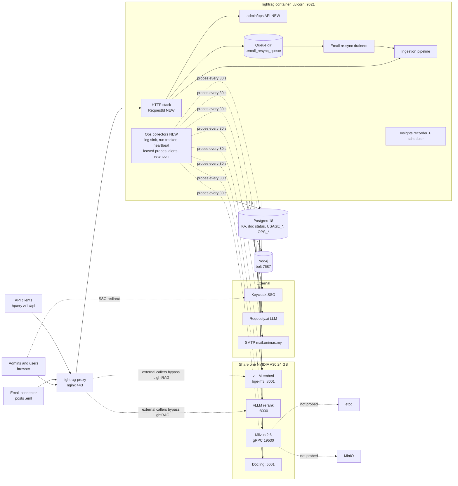

# Admin Operations Dashboard — PRD, UI design and implementation plan

- **Repo:** `/Users/opsohebat/Projects/Python/lightrag-enterprise` (fork). PRs go against the fork's `main`.
- **Date:** 2026-11-03.
- **Status:** proposal, revised after the grounding, scale/concurrency and security/UX reviews; revision 2 adds motion and topology. No code has changed.
- **Markers:** `file:line` points at the current code. **NEW** marks anything that does not exist yet.

## 0. Ground truth and decisions

### 0.1 Facts checked against the code

| Claim | Verified at |
|---|---|
| The image runs single-process Uvicorn. Gunicorn runs only when the container is started with `gunicorn` or `lightrag-gunicorn`. If `GUNICORN_CMD_ARGS` is set while the image `ENTRYPOINT` is used, `main()` returns early and the container exits. No compose file overrides `command:` on `lightrag`. | `Dockerfile:110`, `lightrag_server.py:2843-2846`, `pyproject.toml:157`, `docker-compose*.yml` |
| `MAX_WORKSPACE_INSTANCES` defaults to 10000, so at 3000 workspaces there is effectively no LRU eviction | `config.py:876`. TTL is 60 min (`config.py:877`). It is stored but not enforced. |
| The Insights router is always mounted. The admin router is mounted only under multi-tenancy. | `lightrag_server.py:1922`, `:1926` |
| `app.state.default_rag` is set only in the multi-tenant branch | `lightrag_server.py:1843` |
| Gunicorn workers switch off `uvicorn.error`, which drops unhandled 500 tracebacks | `gunicorn_config.py:158-162` |
| Gunicorn uses `preload_app=True`. State created at module import is shared by every forked worker. | `gunicorn_config.py:31-32` |
| `/health` is whitelisted with no auth. It calls the mutating `cleanup_keyed_lock()`. The WebUI reads `/health` for every user (`configuration.max_graph_nodes`, `pipeline_busy`, `pipeline_active`, and `keyed_locks.current_status.*` in `StatusCard`). | `config.py:747`, `lightrag_server.py:2448-2587`, `:2519`, `lightrag_webui/src/api/lightrag.ts:109-115,562-575`, `stores/state.ts:62,82,105-106`, `StatusCard.tsx:46-60,155-161` |
| `get_keyed_lock_status()` returns a flat dict. `cleanup_keyed_lock()` returns `{cleanup_performed, current_status}`. | `shared_storage.py:1121-1146` vs `:1149-1173` |
| `/health` logs the raw `LIGHTRAG-WORKSPACE` header at WARNING when it is invalid, with no auth | `lightrag_server.py:727-731`, `:2490` |
| Busy acquire runs `get_docs_by_statuses` while holding the keyed `pipeline_status` lock and writes a UTC `job_start` | `pipeline.py:1036-1066` |
| With `workers=1`, `pipeline_status` lives in local process memory. Under Gunicorn it lives in the Manager. | `shared_storage.py:1176-1196` |
| The namespace lock is a Manager keyed lock with no owner tracking and no timeout, acquired synchronously on the event loop | `shared_storage.py:445-471`, `:622-646`, `:1549-1556` |
| `get_namespace_data` is a coroutine. It enters `get_internal_lock()` (one Manager lock shared by all workers, acquired synchronously), so it cannot run in `to_thread`. Each key read on the returned proxy is one more IPC. | `shared_storage.py:155-171`, `:1071-1084`, `:1218-1242`, `:1470-1508` |
| The provider-pause exit clears `busy` itself (`busy_released_in_loop`) | `pipeline.py:1102-1108` |
| Doc-status `metadata` is **replaced** on every upsert. Only whitelisted keys carry over between states, and `failure` is not one of them. | `postgres_impl.py:4904`, `utils_pipeline.py:204-251`, `pipeline.py:2366-2368` |
| Failed rows store `str(error)`. Cancellation messages vary ("User cancelled during entity extraction", "…during merge phase", and so on). Only `pipeline.py:2382` writes the bare "User cancelled". | `pipeline.py:2620`, `operate.py:2152,2507,2942,2986,3091,3313,3674`, `exceptions.py:107` |
| `dup-*` rows are written as FAILED and never removed | `pipeline.py:810-843` |
| The worst PII log line | `postgres_impl.py:2146`: `logger.error(f"PostgreSQL database,\nsql:{sql},\ndata:{data},...")` |
| Other PII at WARNING+: `file_path` in duplicate and failure lines, the full traceback appended to `history_messages`, chunk data, entity names | `pipeline.py:805-808,2581,2593-2596,2602`, `operate.py:1195,1563,2499,4410,5415` |
| The cross-workspace SQL is an unordered `SELECT DISTINCT … status = ANY($1)`. Every doc-status index leads with `workspace`. The PK is `(workspace, id)`. | `postgres_impl.py:4442-4453`, `:1847-1880`, `:6892` |
| `_create_pagination_indexes` runs in every process at startup inside `check_tables()`, awaited before the server serves. Its existence check reads `pg_indexes`, which also lists INVALID indexes. | `postgres_impl.py:1742-1745`, `:1847-1910`, `:2361-2364` |
| `updated_at` is a naive `TIMESTAMP`. The application always writes naive **UTC**. | `postgres_impl.py:6891`, `:4005-4030`, `pipeline.py:2362` |
| Insights doc counts are a full GROUP BY that excludes dup rows | `insights/store.py:918-928` |
| `PostgresUsageStore.try_lease` stores only an expiry float, with no holder and no renewal | `insights/store.py:807-821` |
| `calls()` already accepts `limit` (default 100) | `insights/store.py:718-740` |
| The recorder already counts lost usage records (`_lost`, `LOST_ROWS_KEY`). Only dropped events go uncounted. | `insights/recorder.py:54-57,60-62,102-105` |
| `emit_event` reaches `LIGHTRAG_USAGE_EVENTS` only while the Insights recorder sink runs. Event detail is filtered to an allowlist. | `insights/recorder.py:64-66`, `insights/service.py:2333-2335` |
| The SMTP helpers | `SmtpSettings` (`provider_alerts.py:50`), `send_email_sync(settings, to, msg)` (`:92`) |
| The masking helpers ("The full name never leaves the server") | `insights/analytics.py:35` `mask_name`, `:53-54` `document_label` |
| Email queue: one file per bundle (sha256), rewritten with `os.replace` and a fresh `queued_at` on every defer. Drainers are per process (`self._drainers`). Backoff is a local variable in `_drain`. A busy slot makes `_apply_batch` return `False` without raising. | `email_resync_queue.py:57-58,66-70,101-126,128-134,159-184,208-210,284-299,326-341` |
| Nothing named `DestructiveSlotBusy` exists in the repo | `grep` |
| Embed/rerank queues are wrapped in `lightrag.py`. Queue stats are found through a `get_queue_stats` attribute on the wrapped function. Each LightRAG instance has its own queues and `max_async`. | `lightrag.py:910-946`, `llm_roles.py:241-246,746-786`, `utils.py:1389` |
| The pipeline, operate and LLM code log through the single `"lightrag"` logger (`propagate=False`). Only some API modules use `lightrag.api.*`. | `utils.py:81-82`, `usage.py:26`, `email_routes.py:77` |
| The access-log filter matches exact paths and drops successful GETs **and POSTs** | `utils.py:362-368,383-389` |
| The sink APIs exist | `add_usage_sink`, `add_event_sink`, `emit_event`, `current_usage_scope` (`usage.py:91,172,182,204`) |
| Workspace IDs are users' email addresses with `@` and `.` replaced by `_` | `auth.py:21-43,428` |
| `require_admin` trusts the JWT `role` claim. Token renewal copies it forward until the 168 h session cap. | `dependencies.py:486-504`, `utils_api.py:126-165`, `config.py:825`, `auth.py:431` |
| No admin audit exists. Impersonation records only a `logger.info`. | `admin_routes.py:355-410`, `grep audit` |
| The setup templates cover dependency services only. The `lightrag` service lives in the base compose file. | `scripts/setup/templates/`, `docker-compose.yml:2-30`, `scripts/setup/lib/file_ops.sh:1161-1175` |
| `ManageWorkspaceSelector` is used only by Providers, and Documents API calls never send `X-Target-Workspace` | `ProviderSettings.tsx`, `api/lightrag.ts:576-590,1004` |
| `_pause_summary` groups by **slot**. `_paused_on_system_key` skips BYO-key workspaces, decrypts each workspace's provider file and loops without a cap. These helpers live in a router mounted only when `enable_workspace_providers` is on. | `system_provider_routes.py:207-266`, `workspace_providers.py:199-213`, `lightrag_server.py:1935-1943` |

### 0.2 Pre-flight checks (PR-0, read-only, before any code)

| # | Question | Why it matters | Safe check |
|---|---|---|---|
| V1 | Is prod one Uvicorn process, or Gunicorn with N workers? (The notes say Gunicorn, but no compose file overrides `command`.) | Decides whether Release busy and orphan detection apply, the logging fixes, and how many worker rows to expect | In the lightrag container only, run `docker exec lightrag ps -o pid,ppid,comm`, and look at PID 1's `comm` and the child count. If you need args, print only argv[0..1]. Never run `docker inspect` on vLLM. |
| V2 | Which graph store does prod use? | Decides the graph probe | `.env` `LIGHTRAG_GRAPH_STORAGE` |
| V3 | How fast do `LIGHTRAG_DOC_STATUS` and `LIGHTRAG_USAGE_CALLS` grow, and how many `dup-*` rows exist? | Index-build timing and log/row budgets. (Timezone is settled: the app writes naive UTC.) | SQL counts |
| V4 | Do the deployed vLLM images serve `/health` and `/metrics` without auth on the compose network? | The vLLM probes depend on it | `curl` from inside the lightrag container |
| V5 | Does anything external poll `/health`, and does it need more than a 200? | Decides the `/health` trim (D6) | nginx config and compose healthchecks |
| V6 | Can `lightrag-proxy` overwrite `X-Request-ID $request_id`, and who owns that config? | Request IDs are trusted only from the proxy | server-side nginx config |
| V7 | Is `pg_trgm` available on prod Postgres? | Decides whether log substring search can go beyond 24 h | `SELECT * FROM pg_available_extensions WHERE name='pg_trgm'` |
| V8 | Which `ADMIN_ACCOUNTS` are support staff rather than engineers? | Decides `OPS_OPERATOR_ACCOUNTS` (D8) | Ask the admin |

**The design works in both process modes.** Host-wide numbers come only from Postgres rows written by every process, or from leased singletons. Single-process mode is shown as "1 worker".

**Multi-worker-only features:** orphan detection, Release busy and the Manager card. In single-process mode, a dead process means the container restarts, and that clears `busy`. The UI hides these features when `/status.process.mode == 'uvicorn'`.

### 0.3 Design decisions

| Topic | **Decision** |
|---|---|
| Source of live job state | **Postgres `LIGHTRAG_OPS_RUNS` is the source of truth** (partial index `WHERE status='running'`), written by a buffered writer. Owner fields (`run_id`, `owner_worker_id`, `owner_pid`, `heartbeat_at`) are added as flat keys to `pipeline_status` for the single-workspace view. There is no new Manager namespace. **Interim (PR-2/3), before run tracking:** an ordered SQL candidate list (in-flight statuses only, most recent first, `LIMIT 50`) read through the **NEW** sync read-only `snapshot_namespace()` helper on a dedicated single-thread executor (2 s timeout, one call in flight), with a 15 s single-flight cache. It is labelled "approximate (interim)". |
| Manager reads | Ops never calls `get_namespace_data` in a loop. **NEW** `shared_storage.snapshot_namespace(ns, ws, keys)` skips the internal lock (that lock only guards namespace creation). It returns `None` if the namespace does not exist and never creates one, then reads only the whitelisted keys. Under Gunicorn it runs on a dedicated executor with `wait_for(…, 2)` and at most one call in flight. On timeout the Manager is marked "unresponsive" and pages render SQL-only. In single-process mode it is called directly. |
| Namespace lock in ops actions | Never a bare `async with get_namespace_lock(...)` in multi-worker mode. **NEW** `try_acquire_namespace_lock(ns, ws, timeout=2)` takes the per-process async gate, then calls `raw.acquire(timeout=2)` in the executor. On timeout it returns `lock_unavailable` with restart guidance, and the timeout is audited. |
| Logs store | **PG WARNING+ by default.** A time-boxed INFO capture for one module (≤60 min, audited) comes in PR-8. **Plain table with batched DELETE retention in v1.** Partition only if measured volume goes above ~1M rows/day. Per-PID JSONL and a raw tail are Phase 2. |
| Reveal and masking | **Logs are never revealable** (redacted at write time, irreversibly). File names are fixed **at the source** (log `doc_id`, not `file_path`) and masked at write time by a path-token masker. Doc `file_path`/`job_name` are masked by default. An audited reveal returns them still run through secret and email redaction (D3). Workspace IDs and owners are shown in full in the app (D9). |
| Latency metrics store | **LLM:** reuse `LIGHTRAG_USAGE_CALLS` (≤24 h) and hourly rollups (7 d). **HTTP, embed, rerank, auth:** per-worker-minute insert-only rows with fixed buckets, rolled up hourly under the retention lease. Windows ≤1 h read minute rows; longer windows read hourly rows. |
| Failure history | `metadata.failure` on the doc_status row holds current state. `"failure"` is added to `_DOC_STATUS_METADATA_CARRY_OVER_KEYS` and cleared when the doc reaches PROCESSED. **NEW `LIGHTRAG_OPS_DOC_FAILURES`** holds history. `attempt` = `count(*)` of earlier failure rows + 1. Older rows with no `error_kind` are grouped by a normalised-message signature. |
| Cancellation detection | `classify_failure` keys on `isinstance(e, PipelineCancelledException)`. SQL over legacy rows uses `COALESCE(error_msg,'') LIKE 'User cancelled%'`. |
| Release stale busy | **Gunicorn only.** The owner must be confirmed dead: heartbeat ≥60 s old **and** OS confirmation (`psutil.pid_exists(owner_pid)` false, or `create_time()` ≠ the recorded start), or a `child_exit` marker. Plus a CAS on `run_id`/`job_start`, the typed workspace name, a reason, `require_live_admin`, operator permission and an audit row. The lock is taken with `try_acquire_namespace_lock`. `request_pending` is left as it is. An alive-but-wedged worker, or a lock held by a dead worker, gets "restart the container" guidance. |
| Retry failed (selective) | **"Run pipeline now"** with dry-run counts and honest copy: it retries all pending and failed docs in the workspace, including user-cancelled ones (`pipeline.py:106-112`). Selective retry is OQ-7. |
| Alert cadence | **60 s under a lease that has a holder and can be renewed.** Email only for critical and serious, claimed before sending (conditional UPDATE). The first week is record-only. `provider_paused` is **in-app only**. Heartbeat and orphan rules are suppressed for 10 min after a `deployment` event, and there is a manual maintenance mode. |
| Heartbeat | **15 s on its own dedicated connection** (not the pool). Alive means a heartbeat under 45 s old. `worker_id = uuid4`, generated in the per-worker lifespan (`ops.runtime.start`), never at import (`preload_app`). |
| Leases | Ops has its own lease rows in `LIGHTRAG_OPS_KV`: `{holder: worker_id, exp}`, renewed when `exp < now OR holder = $me`. Each lease outlasts its worst-case cycle (sum of timeouts). Not `insights.try_lease`. |
| SSO role fix | **`useAdminCapability()`** probes `GET /admin/ops/status` once per session when the SSO role is null. It caches **only** 200 (true) and 403 (false), and retries other results with backoff. It gates **both** the Insights and Operations tabs. The stored role is not rewritten. The server stays the authority. |
| Admin authority for mutations | **NEW `require_live_admin`** on every POST, export and reveal. It re-checks the current `ADMIN_ACCOUNTS` (or the Keycloak service-account allowlist), refuses impersonated sessions, and records `auth_kind`/`impersonated_by`. Forceful actions also need `OPS_OPERATOR_ACCOUNTS` when it is set (D8). |
| Navigation | **Overview · Processing · Logs · Health · Performance · Activity**, with the correlate box in the page header. |
| Streaming | **Poll with cursors.** There is no EventSource precedent, SSE needs nginx `proxy_buffering off`, and its auth would bypass the axios interceptors. |
| Timeline markers | Read-time merge of `LIGHTRAG_USAGE_EVENTS` (deployment, model_change, provider_rejection, ingestion_resumed) with `OPS_AUDIT` and `OPS_RUNS`. Ops never writes into `USAGE_EVENTS`. |

### 0.4 Decisions for the admin to make

| # | Decision | Recommendation |
|---|---|---|
| D1 | Alert recipients: the same `ALERT_EMAIL_TO` as provider alerts, or a separate `OPS_ALERT_EMAIL_TO`? | Use `OPS_ALERT_EMAIL_TO`, falling back to `ALERT_EMAIL_TO`. |
| D2 | How long to keep WARNING+ logs in Postgres | **14 days** for logs and **400 days** for audit. Revisit after one week of measured volume. |
| D3 | Can admins reveal real document names and email subjects? | **Yes, per field, with a reason, audited, auto-hidden after 60 s with a "Keep visible" option, and still secret-redacted.** Log text is never revealable. |
| D4 | Should "Release stale busy" become automatic when a worker dies? | **No, keep it manual in v1.** Reconsider after three clean manual releases. |
| D5 | GPU metrics: a sidecar exporter, NVML in the API container, or vLLM `/metrics` only? | **vLLM `/metrics` in v1.** Add an `nvidia_gpu_exporter` sidecar in Phase 2. Do not give the API container `runtime: nvidia`. |
| D6 | Trim the unauthenticated `/health`? | **Yes, in PR-3 (after V5).** Anonymous callers get liveness only (`HEALTH_DETAIL=authenticated` by default). Any valid token, admin or not, gets the current detail, so the WebUI keeps working. Userinfo is stripped from hosts. `LIGHTRAG-WORKSPACE` is ignored on unauthenticated calls. |
| D7 | Is a "pause email re-sync for this workspace" control needed? | **Not in v1.** Make cancel semantics visible first. |
| D8 | Is a separate operator tier needed? | **Optional `OPS_OPERATOR_ACCOUNTS`.** When set, only those accounts can release busy, reveal, export, capture INFO and edit thresholds. Read views, cancel, run now and drain stay open to all admins. When unset, all admins are operators. Fill it in from V8. |
| D9 | Workspace IDs are derived from owner emails. Mask them in the app? | **No. Admins see workspace IDs and owners in full in the app**, which matches Insights (`insights/service.py:1058,1210`). Alert emails carry neither: the subject holds rule and severity only, and the body holds counts and a link. Document file names stay masked. |

---

## 1. PRD

### 1.1 Problem

Admins cannot tell from inside the product whether LightRAG is healthy, what it is doing across about 3000 workspaces, or why something failed.

- **Processing state is per workspace only.** Each `/documents/*` call can instantiate a LightRAG (`document_routes.py:2617-2627`).
- **There are no logs in the app.**
  - `history_messages` has no timestamps.
  - It is wiped on every run (`pipeline.py:1063`), on every email bundle delete (`email_routes.py:413`), on every email-queue batch with deletes (`email_resync_queue.py:227-231` → `_mark_deletion_job`), and on single-document deletion (`lightrag.py:2810-2813`).
  - `lightrag.log` sits in an unmounted `/app`, mixes two line formats, rotates racily and contains PII.
- **`/health` is public, checks nothing and leaks configuration.** It hardcodes `status: "healthy"`, exposes hosts and directories, and calls a mutating lock cleanup.
- **Under Gunicorn, a dead worker strands its workspace.** `busy=True` stays in the Manager with no owner or heartbeat. A worker killed mid-upload or mid-scan can also leave `pending_enqueues>0` or `scanning=True`, and either one blocks the email re-sync's destructive slot forever (`document_routes.py:1110-1120`).
- **The email re-sync queue has no API**, although it is the dominant load.
- **FAILED counts are misleading.** They mix real failures, cancellations (many message variants) and `dup-*` rows.
- **Troubleshooting needs SSH and `docker logs`**, and running `docker inspect` on vLLM prints its API key.
- **No admin action is audited**, including impersonation and workspace deletion.

### 1.2 Goals

- **G1.** Within 60 seconds and without SSH, answer four questions: Is it healthy? What is processing? What is stuck? Why did this fail?
- **G2.** Every red signal drills down: symptom → component or workspace → run or document → its LLM calls and redacted log lines. The join keys are `workspace`, `run_id`, `track_id`, `doc_id` and `request_id`.
- **G3.** Numbers are correct whatever the process model and whichever worker answers.
- **G4.** It works at 3000 workspaces: no per-workspace fan-out, SQL aggregates with `LIMIT`, server pagination.
- **G5.** Safe by construction:
  - Admin rights are enforced on the server, and checked live for mutations.
  - Secrets never leave the server.
  - PII is fixed at the source and redacted at write time.
  - Every ops action, reveal and export is audited, and so are the existing admin mutations from PR-7 on.
- **G6.** A small set of guarded actions: cancel, run now, drain email queue now, and release stale busy (Gunicorn only).
- **G7.** Proactive, deduplicated alert email, so nobody has to watch the dashboard.

### 1.3 Non-goals (v1)

- Prometheus, Grafana, Loki or OpenTelemetry. Optional phases are in §3.12.
- Logs from other containers (nginx, vLLM, Postgres, Milvus). That needs the Docker socket. Those services appear as probes instead.
- Replacing Token Insights (cost, tokens, budgets, forecasts, cost anomalies) or the Documents tab.
- Arbitrary commands, container restarts, editing config, bulk actions across workspaces.
- Acting on another workspace's documents from the Documents tab (no "Open in Documents" in v1; see OQ-10).
- Synthetic LLM completions on a schedule, because `_test_provider` costs money (`system_provider_routes.py:128`).
- A view for workspace owners. Translations beyond `en.json` (the Insights precedent).

### 1.4 Personas

| Persona | Context | Primary question |
|---|---|---|
| **P1 On-call platform admin** (primary) | Gets an alert email or a user complaint; on a laptop or phone | "Is it broken, where, since when, and can I fix it without SSH?" |
| **P2 Support admin** | A ticket says "my document or email isn't searchable"; in `ADMIN_ACCOUNTS` but not an engineer, and possibly not in `OPS_OPERATOR_ACCOUNTS` | "What happened to this workspace or document, in plain language? Can I retry it safely?" |
| **P3 Engineer** | Debugging a regression after a deploy, holding a request ID or traceback fragment | "Which component and code path, which log lines, since when?" |
| **P4 Auditor / capacity planner** (secondary) | Periodic review | "Who did what? Are we near the limits on Postgres connections, the reranker or disk?" |

### 1.5 User stories and acceptance criteria

**US-1 (P1) Triage at a glance.**
- The Overview shows an overall state (Healthy / Degraded / Down / Unknown / Maintenance), a KPI row, a "Needs attention" list and a workers strip.
- Server p95 is ≤300 ms with a warm cache, and the first render is ≤1.5 s, at 3000 workspaces and 2M doc rows.
- Every tile shows how old its data is. A tile older than 2× its refresh interval shows as **Stale** and is never green.
- Every tile and attention item is a link (`<a href="#…">`) to its drill-down, with filters already set.
- When there are no issues, the panel says what was checked, for example: "No issues. Checked doc status for 3,012 workspaces, 4 running runs and the email queue at 12:04:31".

**US-2 (P1/P2) Live processing.**
- Active runs across all workspaces, showing workspace, kind, trigger, started, elapsed, last progress, docs done/total, worker and state.
- Backlog by status, with `dup-*` excluded and every cancellation variant shown separately.
- A test proves that no GET calls `get_instance` (§3.11).

**US-3 (P1/P3) What is stuck.** Five flags, each with a plain-language reason (for example "Worker 2 (pid 4121) stopped reporting 7 min ago while holding this workspace."):

| Flag | Meaning | Mode |
|---|---|---|
| **Orphaned** | The owner worker is confirmed dead | Gunicorn only |
| **Hung** | The worker is alive but no progress for ≥`OPS_STALL_MINUTES` (default 15). Runs that ended on a provider pause are `paused`, never hung. | both |
| **Stale doc** | A doc has been in parsing, analyzing or processing longer than a threshold (default 60 min) | both |
| **Busy without run** | `busy=True` with no live run row | both |
| **Reservation without owner** | `scanning=True` or `pending_enqueues>0` with no live scan or enqueue owner, which blocks the destructive slot. v1 shows restart guidance. | Gunicorn |

- The stuck list loads in under 500 ms at 3000 workspaces.

**US-4 (P2) Workspace drill-down.**
- Server-side search by workspace name, owner, or owner email (debounced 250 ms).
- The drawer shows: live state, counts, a redacted live feed (last 200 lines), recent runs, failures by kind, email queue state, provider pause, and "action in progress by X" when another admin is acting.
- Opening the drawer never instantiates the workspace. `loaded_in` lists the workers that have it loaded (from heartbeats). If it is loaded nowhere, the drawer says "Idle (not loaded in memory)" and still shows counts from SQL.

**US-5 (P2/P3) Why did this fail.**
- The Document drawer shows a stage timeline (from the `metadata.*_start_time` fields), failure history (stage, `error_kind`, model, attempt n), the LLM calls for that `doc_id`, and log lines for that `doc_id`.
- Failure analysis groups by `error_kind`, stage, workspace or model. Duplicates and cancellations are shown separately.

**US-6 (P3) Logs and correlation.**
- Filters: level, time, module, workspace, request_id, run_id, track_id, doc_id, and substring (within a 24 h window).
- A query over 24 h returns within 1 s (p95). Pages hold at most 500 rows and use a `(ts, id)` keyset cursor.
- Follow mode polls every 5 s, never skips rows that commit late, and pauses when the user scrolls away.
- A grouped-by-call-site view is available.
- Every response carries `X-Request-ID`, and WebUI error toasts show `Ref: <id>`.
- Pasting any ID, or an owner email, into the correlate box lands on the right inspector.

**US-7 (P1) Dependency health.**
- Each card shows status, probe latency, last OK time, consecutive failures, error class and a 24 h availability strip.
- Probes run once per host per interval (under a lease), however many people are viewing, on a dedicated executor so a hung probe cannot starve other work.
- No probe sends a paid completion or returns a secret.
- TLS certificate expiry (proxy and SMTP) and Postgres blocking are shown.

**US-8 (P3/P4) Performance.**
- LLM p50/p95/p99 and error, truncated and abandoned rates by purpose and model for 15 m, 1 h, 24 h and 7 d.
- Embed, rerank and HTTP latency.
- Concurrency now: summed running/queued across all instances, the busiest instances, vLLM waiting, PG connections.
- Deploy and provider-rejection markers.
- LLM latency carries the label "includes queue wait and retries" (`llm_roles.py:277,298`).

**US-9 (P1/P2) Safe actions.**
- Every action dialog states its real effect.
- Forceful actions require typing the workspace name.
- Every action needs a reason and writes an intent audit row **before** acting and a result row after. If the audit write fails, the action is refused.
- Only one action per workspace runs at a time. A second admin sees "in progress by X".

**US-10 (P1) Alerts.**
- One email when an incident opens and one when it resolves, deduplicated across workers, with a deep link and a runbook step.
- No log text, workspace ID or owner in the email.
- Mutes, acks, maintenance mode, deploy suppression, and an "alert email is broken" banner.

**US-11 (P4) Audit.**
- The Activity tab lists ops actions, reveals, exports and log searches (filters hashed). From PR-7 on it also lists the existing admin mutations (impersonation, workspace delete, owner change, provider changes, admin `/documents/*` mutations on another workspace).
- Until PR-7 the section is labelled "Operations actions only".
- Filterable, and exportable as CSV (POST, reason, formula-safe). There is no delete or update API.

### 1.6 Functional requirements

**System Overview**
- **FR-1** `GET /admin/ops/overview` returns one payload in a single request: state, KPIs, attention, workers, a 6 h timeline, the top 5 active runs, a dependency summary and the alert-channel state.
- **FR-2** The overall state comes from the attention snapshot computed under lease (`ops:reconcile`, later `ops:alerts`) and stored in KV. Workers do not re-evaluate rules. The worst open severity wins. Postgres down, or zero live workers, means Down. An active maintenance mode shows as Maintenance.
- **FR-3** KPIs:
  - Active runs (with the longest one)
  - Backlog (in-flight docs, 1 h delta)
  - Real failures in 24 h (+ cancelled)
  - Stuck (runs + docs + reservations)
  - Email queue (records, longest-pending workspace age)
  - LLM error rate and p95 over 15 min
  - Dependencies (OK / total)
  - Workers alive vs expected
- **FR-4** Every value carries a scope: **host** (Postgres-backed) or **worker <pid>**. Per-worker values never appear on the Overview.
- **FR-5** The timeline shows docs processed and failures per hour, with markers merged at read time from `LIGHTRAG_USAGE_EVENTS`, `OPS_AUDIT` and `OPS_RUNS` (orphaned).

**Live Processing**
- **FR-10** Active runs come from **NEW** `LIGHTRAG_OPS_RUNS WHERE status='running'`, enriched with `snapshot_namespace` flags for those workspaces only (at most 50).
- **FR-11** Backlog totals come from one SQL aggregate over `LIGHTRAG_DOC_STATUS` using the **NEW** partial index (status lists inlined as literals). Cached for 10 s.
- **FR-12** Workspaces-with-backlog table: server pagination (50 per page, max 200), search by name or owner, sort in SQL (in-flight, failed, oldest, name), filters (has failed, has stuck, email pending, paused).
- **FR-13** A stuck detector covering the five classes in US-3. Thresholds are configurable in `LIGHTRAG_OPS_KV`.
- **FR-14** Failure analysis over 1 h, 24 h or 7 d, grouped by `error_kind`, stage, workspace or model, with first and last seen and a masked example. Older rows with no `error_kind` are grouped by a normalised-message signature.
- **FR-15** Email re-sync queue:
  - Fields: total pending records, workspaces with pending records, per-workspace `first_pending_at` (KV, set when the scan first sees pending > 0, cleared at 0), `.bad` count, drains in the last hour (ok / failed / slot busy), last result class, attempts per workspace, and live drainer and backoff per worker (from heartbeats).
  - **The contents are never returned. The scanner never opens files and never takes the flock.**
- **FR-16** Provider pauses: counts by **slot** and kind, plus a paginated list of workspaces, including BYO-key pauses flagged `byo`.
  - PR-2 uses a dedicated ops reader over the capped candidate set.
  - From PR-4, pause set and clear events are persisted at the `PROVIDER_PAUSE_KEY` write sites, and the summary is plain SQL.
  - Route-private helpers are not imported, so this works whatever `enable_workspace_providers` is set to.
- **FR-17** Run history for 30 days:
  - kind: process, email_batch, delete, clear, email_delete, scan, startup_resume, admin
  - trigger
  - duration
  - docs ok/failed
  - outcome: succeeded, failed, cancelled, paused, orphaned; `was_orphaned` marks runs that later recovered

**Logs viewer**
- **FR-20** Query **NEW** `LIGHTRAG_OPS_LOGS`, WARNING and above. Filters as in US-6. The window is at most 7 days per query, and at most 24 h when `q` is set (unless V7 allows `pg_trgm`). `statement_timeout` is 3 s on ops reads.
- **FR-21** Keyset pagination on `(ts, id)`. 100 rows by default, 500 maximum.
- **FR-22** Follow mode re-queries `ts >= last_ts - 10 s` every 5 s while the tab is visible and the user is at the newest edge. The client de-duplicates by `id`.
- **FR-23** A grouped view by `fingerprint` (call site: logger, module, lineno, exc_type, level): count, first and last seen, sample, workspaces.
- **FR-24** Entry drawer: the full redacted message and traceback, context fields, and pivot buttons (same request, same run, same doc, same fingerprint, open doc, open workspace).
- **FR-25** Export: `POST /logs/export` with a reason. NDJSON of the current filter, at most 10k rows, `exc` left out unless asked for, already redacted, audited, operator-only.
- **FR-26** Time-boxed INFO capture for one module, at most 60 min, audited, expiring automatically (PR-8).
- **FR-27** The live per-workspace feed stays `history_messages`, redacted on read, with a `reset` flag. Logs are never re-parsed to build it.

**Health and dependencies**
- **FR-30** Dependency grid: Postgres, Milvus (healthz plus version), graph store, Redis (if configured), vLLM embed, vLLM rerank, LLM provider (passive), Docling, SMTP, IdP, the Manager (multi-worker only), Insights recorder, ops log sink, disk, TLS certificates (proxy, SMTP STARTTLS) and sign-in.
- **FR-31** Probes:
  - They run every 30 s on the lease holder, on a dedicated `ThreadPoolExecutor(max_workers=4)`, each with its own timeout and a client-side deadline.
  - At most one probe per dependency runs at a time. If the previous one is still running, the cycle records `down: probe hung`.
  - The latest result goes to KV and history goes to `LIGHTRAG_OPS_PROBES`.
  - "Re-check" is limited to one every 10 s per dependency, host-wide.
- **FR-32** Workers table: pid, mode, uptime, heartbeat age, RSS, CPU, fds, threads, loaded instances, event-loop lag, Manager round-trip time, PG pool (size, idle, max, acquire wait), queue sums per role (running, queued), recorder health (buffer, last flush, lost rows, dropped events), log sink (buffer, dropped, rate-limited) and resync drainers (workspaces, backoff deadline).
- **FR-33** Host panel: container memory and CPU from cgroup v2, host load average (labelled "host"), disk usage of the working directory and `LOG_DIR`, Postgres database size, connections against `max_connections`, and blocked/blocking backends.
- **FR-34** Config summary (admin, redacted): built from the `/health` configuration block with userinfo stripped from URLs. The Worker drawer embeds `StatusCard`.
- **FR-35** Sign-in health: SSO callback errors, 401s on token validation, and `login_throttle` lockouts, per 15 min and 24 h. Source: **NEW** `auth` series counters (outcome only, no usernames).

**Performance**
- **FR-40** LLM latency percentiles and rates come from `LIGHTRAG_USAGE_CALLS` for windows up to 24 h. The 7 d window uses hourly rollups and shows average and max only, labelled as such.
- **FR-41** Embed and rerank p50/p95/p99 and error rate come from **NEW** timing wrappers placed **inside** the queue wrapper, plus vLLM `/metrics` (running, waiting, KV cache; parsed off the event loop).
- **FR-42** HTTP latency and 5xx rate per route template come from a **NEW** timing step inside the request-ID middleware. Requests with no matching route are keyed `<unmatched>`, and distinct keys are capped at 200 per minute.
- **FR-43** Throughput: docs processed and failed per hour (runs), LLM calls per minute (≤24 h), email batches per hour.
- **FR-44** Concurrency now: summed `running`, `in_flight` and `queued` per role across every loaded instance and worker, plus the top 10 instances by queued and running. An optional `OPS_PROVIDER_CONCURRENCY_BUDGET` gives a ratio. There is **no ratio against summed `max_async`**, because those limits are per workspace.
- **FR-45** Top 20 workspaces in the window by LLM calls, processing minutes or failures, via SQL `ORDER BY … LIMIT 20`.
- **FR-46** Event markers on every chart.

**Drill-down and troubleshooting**
- **FR-50** Correlate box: paste a request_id, run_id, track_id, doc_id, `ws/doc`, workspace, or owner email, and land on the matching inspector.
  - A doc_id is resolved through `OPS_DOC_FAILURES`, `idx_ops_logs_doc`, and the **NEW** `LIGHTRAG_DOC_STATUS (id)` index, with `LIMIT 10`.
  - An email is resolved to a workspace through the registry.
  - Ambiguous input lists its matches.
- **FR-51** Drawers: Workspace, Run, Document, Log entry, Dependency, Worker, Alert. They can be addressed from the URL and carry an in-drawer breadcrumb.
- **FR-52** The drill state lives in the URL hash (`ops=1&otab=…&ows=…&orun=…&odoc=…&olog=…&odep=…&owk=…&olq=…`), so links can be pasted into chat. Alert emails link only to the alert (`oal`).
- **FR-53** Plain-language "explain" text for these states: stalled, orphaned, paused by provider, cancelled-will-retry, feed-was-reset (run start, email bundle replace, email-queue batch with deletes, single-doc delete), and reservation-without-owner.
- **FR-54** Cross-tab links: "Open in Insights" (`#/?insights=1&itab=explore&iws=<ws>&idoc=<doc_id>`; `idoc` is **NEW** in the Insights hash) and "Providers" for pauses. "Copy workspace ID" replaces "Open in Documents" in v1.

**Admin actions**
- **FR-55** Actions: cancel pipeline, run pipeline now, drain email queue now, release stale busy (Gunicorn only), re-run probes, test SMTP (no send), reveal a doc field, mute or ack an alert, maintenance mode, INFO capture.
- **FR-56** Each action:
  - has a reason of 3 to 512 characters
  - passes `require_live_admin` (plus operator permission where D8 applies)
  - re-checks its preconditions on the server under a lock taken with a timeout
  - writes an intent audit row before acting and a result row after
  - takes a per-workspace action lease (`action:<ws>`, 60 s)
  - is idempotent (a no-op returns its cause)
  - is limited to 10 actions per minute per actor

**Alerts**
- **FR-60** Rules are evaluated every 60 s under lease `ops:alerts`. The evaluator writes the attention snapshot that the Overview reads. Default thresholds are in §1.7. Each rule carries a runbook step (and an optional `OPS_RUNBOOK_BASE_URL` link).
- **FR-61** State machine: firing → resolved. Acks are kept in the `acked_by`/`acked_at` columns, and state does not change. The unique open fingerprint is enforced with `WHERE resolved_at IS NULL`. Mutes for 1, 4 or 24 h (max 7 days) and maintenance mode are audited. History is kept 180 days.
- **FR-62** Email:
  - Sent through `SmtpSettings` and `send_email_sync` in the probe executor.
  - Only for critical and serious, when an incident opens and when it resolves, repeating every `ALERT_EMAIL_REPEAT_HOURS`.
  - Claim before sending: `UPDATE … SET last_emailed_at=now() WHERE id=$1 AND (last_emailed_at IS NULL OR last_emailed_at < $cutoff) RETURNING id`. Send only if a row comes back.
  - The body carries rule, severity, scope counts, since, the runbook step and a link. Never log text, workspace IDs or owners.
- **FR-63** An "alert email is not being delivered" banner when the SMTP probe fails or SMTP is not configured.
- **FR-64** Deploy handling:
  - Heartbeat and orphan rules are suppressed for 10 min after a `deployment` event.
  - The worker rule compares live workers with expected workers. It does not fire per stale row.
  - Rows from a previous boot on the same host are marked `superseded` when a new worker starts.
- **FR-65** Incident timeline export: `POST /activity/export` over a window (alerts, audit, runs, markers; no log text), with a reason and an audit row.

**Security and privacy**
- **FR-70** Every `/admin/ops/*` route sits behind a router-wide `Depends(require_admin)` (`dependencies.py:486`). Mutations, exports and reveals add `require_live_admin`. The router is always mounted, next to `insights_router`. Data access falls back to the server's `rag` when `app.state.default_rag` is not set.
- **FR-71** The UI shows the tab if `role==='admin'`, or if the SSO role is null and `GET /admin/ops/status` returns 200.
- **FR-72** Redaction runs at write time on the ops sink **and** on the text file and console handlers. It runs again on read for legacy text (`history_messages`, `latest_message`, `error_msg`, `job_name`, `provider_rejection.message`). Messages are capped at 2 KB and tracebacks at 8 KB. It covers:
  - emails
  - `Bearer`, `sk-…`, JWTs
  - `api[_-]?key|token|secret|password=`, `Authorization:`
  - DSN userinfo
  - `data:…;base64,` blobs
  - long base64 or hex runs (40+ characters)
  - digit runs of 12 or more
  - Malaysian IC numbers `\b\d{6}-?\d{2}-?\d{4}\b`
  - Malaysian phone numbers `(\+?6?0)[\s-]?1\d[\s-]?\d{3,4}[\s-]?\d{4}`
  - path-like tokens (`__master|attachment_` shapes and `*.pdf|docx|xlsx|pptx|txt|eml|msg`), masked with `mask_name`
- **FR-73** Fixes at the source (PR-1): see §3.8.1.
- **FR-74** Never returned: email queue `components`, process `cmdline`/`environ`, container env, args or command, raw log files, URLs with credentials, API keys, SQL parameters.
- **FR-75** Audit:
  - every ops action, reveal, export and mute
  - every log search (filters stored as a hash plus field names, deduplicated per actor per filter hash per 5 min)
  - from PR-7, the existing admin mutations through one shared audit helper
- **FR-76** Responses carry `Cache-Control: no-store`. Error bodies are `{detail:<code>, request_id}` and never contain `str(e)`, unlike `admin_routes.py:297-304`.
- **FR-77** CSRF protection on mutating routes and exports: POST only with a JSON body, the `X-LightRAG-Client: webui` header (axios already sends it, `api/lightrag.ts:362-370`), and an `Origin` check, together with the SSO cookie's `SameSite=lax`.
- **FR-78** Workspace deletion **deletes** that workspace's rows in `OPS_LOGS`, `OPS_DOC_FAILURES` and `OPS_RUNS`, removes `resync:<ws>` and other per-workspace KV entries, and rewrites alert titles and scope to a hashed workspace. `OPS_AUDIT` is exempt: actor and action are kept, and the workspace is replaced by `sha256[:16]`.
- **FR-79** `X-Request-ID` is trusted only when the TCP peer is in `OPS_TRUSTED_PROXIES` (the `lightrag-proxy` container, after V6). Otherwise a new ID is generated and the client's value goes into `client_request_id`.

**Motion**
- **FR-90** Motion follows the §2.12 catalogue.
  - Every animation is triggered by a user action or by a diff against the previous poll. A poll that changes nothing produces no animation and no re-render.
  - Baseline polls (after mount, a hidden tab, a resume or error recovery) replay nothing.
  - At most one ring plays at a time, in priority order: state chip, then critical attention item, then failing node. The same target and rank rings at most once per 10 min.
  - Values, charts and strips are final on first paint. There are no intros, and charts never animate.
  - A KPI tint plays only on a severity change. Every change also shows as text.
- **FR-91** Reduced motion applies when the OS reports `prefers-reduced-motion: reduce` or the header "Reduce motion" toggle is on.
  - All transforms, rings and loops are then off, and only opacity or colour changes of ≤ 150 ms remain. This includes ops-owned Radix overlays rendered in portals (`ops-portal`).
  - `⏸ auto` stops polling and every loop.
  - No loop runs for more than 5 s unless one of these controls can stop it (WCAG 2.2.2). The skeleton stops after 4 s, and the hairline turns into text at 5 s.
  - While `document.hidden`, nothing animates, and the first poll after return applies current values without replaying missed changes.

### 1.7 Default alert and attention thresholds (editable in `LIGHTRAG_OPS_KV`)

| Rule | Warning | Serious / critical | Condition |
|---|---|---|---|
| `workers_below_expected` | live < expected | crit: live = 0 | 2 ticks; suppressed 10 min after deploy |
| `manager_rtt` (multi-worker) | > 200 ms | crit: fail or unresponsive | 2 consecutive |
| `pg_probe` (dedicated connection) | > 100 ms | crit: fail or > 1 s | 2 consecutive |
| `pg_pool_wait` (per worker) | > 500 ms | serious > 5 s | 2 consecutive |
| `pg_connections` (used / `max_connections`) | ≥ 70 % | serious ≥ 90 % | 2 consecutive |
| `pg_blocked` | any blocked > 30 s | serious > 120 s | |
| `dependency_down` (Milvus, graph, vLLM, Docling, IdP) | slow > 500 ms | crit: down | 3 consecutive probes |
| `vllm_waiting` | > 20 | serious > 100 | for 2 min |
| `llm_error_rate_15m` | > 5 % | serious > 20 % | ≥ 20 calls |
| `llm_p95_15m` vs 7-day same-hour baseline (computed hourly under lease, stored in KV) | > 2× | serious > 4× or > 60 s | ≥ 20 calls |
| `provider_paused` | | crit (**in-app only**) | already emailed by `provider_alerts.py` |
| `embed_rerank_error_rate_15m` | > 2 % | serious > 10 % | ≥ 50 calls |
| `run_orphaned` (Gunicorn) | | crit | owner confirmed dead; suppressed 10 min after deploy |
| `run_hung` | > 15 min with no progress | serious > 45 min | excludes `paused` |
| `reservation_without_owner` (Gunicorn) | | serious | > 5 min |
| `stale_docs` | any > 60 min | serious: any > 180 min | |
| `oldest_pending` | > 2 h | serious > 6 h | |
| `failure_spike` (real failures in 1 h, cancellations excluded) | > 3× the 7-day hourly median and > 20 | serious > 100 or > 30 % of processed | |
| `email_queue_stalled` | pending > 0 and no successful drain for > 30 min | serious > 2 h | uses drain-result KV and `first_pending_at` |
| `email_queue_bad` | > 0 | | |
| `email_ingest_silence` | no email ingest call for > 140 min (2× the ~70 min cycle) | serious > 6 h | KV `email:last_ingest_at` |
| `http_5xx_rate_5m` | > 1 % | serious > 5 % | ≥ 100 requests |
| `unauth_warning_lines_5m` | > 50 | | WARNING lines from unauthenticated paths |
| `signin_failures_15m` | SSO callback errors > 5 or lockouts > 3 | serious > 20 | |
| `tls_cert_expiry` | < 21 days | crit < 7 days | self-signed is shown, not alerted, unless `OPS_TLS_REQUIRE_TRUSTED=true` |
| `disk_free` | < 15 % | crit < 5 % | |
| `log_sink_or_recorder_drops_5m` | > 0 | serious > 1000, or last flush > 60 s | |
| `smtp_probe` | fail | | 2 consecutive |

### 1.8 Non-functional requirements

| ID | Requirement |
|---|---|
| NFR-1 Latency | `/overview`, `/processing/summary`, `/health`, `/workers`: server p95 ≤ 300 ms with a warm cache. Drawers ≤ 500–800 ms. Log query over 24 h ≤ 1 s. Correlate ≤ 500 ms. **Load fixture:** 3000 workspaces, 2M doc_status rows (plus 200k `dup-*`), 3M log rows, 2M usage calls. |
| NFR-2 Polling cost | One open tab averages ≤ 1 request/s (≤ 0.5 when idle on the Overview). Polling pauses when `document.hidden` and backs off on errors (×2, up to 120 s). Each worker has single-flight caches in a bounded LRU (256 entries, normalised keys, TTL 5–15 s), so DB load does not grow with viewers. Successful ops **GETs** are excluded from the access log. POSTs are kept. |
| NFR-3 No fan-out | No GET calls `workspace_manager.get_instance()`. No GET calls `get_namespace_data` in a loop. Manager reads go through `snapshot_namespace` for ≤50 SQL-selected candidates (≤200 in the leased reconcile loop). No per-workspace glob, no per-workspace provider decrypt, no Milvus `get_collection_stats`. Only an explicit single-workspace action may instantiate. |
| NFR-4 Multi-worker correctness | Every number is host-wide (Postgres or a leased singleton) or labelled with its worker. Overview values must match between 1-worker and 3-worker test runs (±1 tick). |
| NFR-5 Non-interference | Ops hooks in the pipeline are best-effort (try/except, never raise), take no new locks, and do no I/O while holding a lock. Writes go through buffered async writers. The heartbeat, leases and PG probe use dedicated connections, not the shared pool. Probes run on their own executor. The log handler never blocks (bounded deque, counted drops, rate limit per fingerprint). Email re-sync throughput and extract p95 may regress by at most 2 % with 3 tabs open. |
| NFR-6 Write budget | ≤ 50 ops rows/s steady state. Estimate: logs ~1–3/s (capped at 20/min per fingerprint), heartbeats ~0.3/s, metrics ~5/s, runs and failures negligible. Measured in PR-5 before the sink is on by default. |
| NFR-7 Retention | `OPS_LOGS` 14 d · `OPS_PROBES` 7 d · `OPS_RUNS` 30 d · `OPS_DOC_FAILURES` 90 d · `OPS_METRICS_MIN` 14 d · `OPS_METRICS_HOUR` 90 d · `OPS_ALERTS` 180 d · `OPS_AUDIT` 400 d · `OPS_WORKERS` rows 24 h after the last beat · `OPS_WORKER_SAMPLES` 7 d. Text log file 50 MB × 10 on a 0700 volume excluded from host backups. Docker console `max-size: 50m`, `max-file: 5`. |
| NFR-8 Degradation | Without PG KV: `/status` returns `features.durable=false`, and only the local process, probes and the single-workspace drawer work. Without Insights: LLM panels show "unavailable". Postgres down: the banner names it and live reads still render. Manager unresponsive: SQL sections still render, labelled. Every panel has its own `ViewBoundary`. |
| NFR-9 Security | Each route has a test proving it is gated. Each mutation has a live-admin test. A redaction corpus test passes (including file paths, IC and phone numbers). An error-body leak test passes. A weekly regex audit over `OPS_LOGS` finds nothing. |
| NFR-10 Accessibility | WCAG 2.1 AA, plus 2.2.1 for revealed values ("Keep visible"). Status is never shown by colour alone. Keyboard-operable tabs and drawers with focus management. Drill targets are real links. `aria-live="polite"` only on the state chip and the "N new" pill. `prefers-reduced-motion` is honoured. Works at 375 px with no horizontal page scroll. WCAG 2.2.2 is met through the "Reduce motion" toggle, `⏸ auto` and the 5 s caps. Motion follows 2.3.3, and nothing flashes more than 3 times a second (2.3.1). Stale text keeps ≥ 4.5:1 contrast, and so does text under the KPI tint. Tweening digits are `aria-hidden` with an `sr-only` final value. Besides the state chip and the "N new" pill, an action-dialog refusal is announced through `role="alert"`. |
| NFR-11 Timezone | Display in `INSIGHTS_TIMEZONE` (Asia/Kuala_Lumpur) with UTC in a tooltip. All new columns are `TIMESTAMPTZ`. Naive `updated_at` is compared with `(now() AT TIME ZONE 'UTC')` through one helper, whatever the server's TimeZone setting. |
| NFR-12 Motion performance | 60 fps (no frame over 16.7 ms from animation work) on a 2019 4-core laptop with integrated graphics, with Logs following at 1000 DOM rows and the Workspace drawer open while the header chip polls. Only `transform` and `opacity` animate, except paint-only colour crossfades, one row's height collapse and `stroke-dashoffset` on ≤ 5 flowing topology edges. Zero forced reflows in animation frames and ≤ 1 batched layout read per poll. An idle Overview uses < 2 % of the main thread with no poll-driven re-renders. Health with flow running uses < 4 %. There are zero animation frames while `document.hidden`. UI durations are ≤ 300 ms. Checked by a Performance trace in the PR and by the snapshot tests. |

### 1.9 Success metrics

- MTTD for an orphaned busy flag (Gunicorn) or a dependency outage: **≤ 5 min**, down from "when a user complains".
- P2 answers "why is doc X not searchable" in **≤ 2 min** without SSH (support drill). P1 answers "healthy / stuck / why" for 5 seeded incidents with a median under 60 s.
- **≥ 70–80 %** of incidents in the first 30 days resolved without SSH (self-reported in alert ack notes).
- **≥ 90 %** of new real failures have `error_kind != 'unknown'` after 2 weeks.
- **Zero** secret, email, IC or file-name matches in `LIGHTRAG_OPS_LOGS` in the weekly audit.
- Dashboard overhead **< 2 %** of Postgres CPU (`pg_stat_statements` before and after). Ingestion regression ≤ 2 %.
- Under Gunicorn, restarts needed for stranded `busy`: **0**, handled with Release instead. Exceptions are locks held by a dead worker and reservations without an owner, which still need a restart and are reported as such.
- Duplicate alert emails across workers or after a deploy: **0**.

### 1.10 Open questions

- OQ-1 to OQ-8 correspond to V1 to V8 above.
- **OQ-9** Selective per-document retry (excluding cancelled docs) needs a pipeline change to the `_INFLIGHT_DOC_STATUSES` selection (`pipeline.py:106`). Is it worth doing?
- **OQ-10** Should parse and analyze workers honour cancellation (`pipeline.py:1489-1700` never checks it)? This is a separate pipeline fix that the dashboard makes visible.
- **OQ-11** Are the `history_messages` wipes intended? They happen on email bundle delete (`email_routes.py:413-414`), on email-queue batches with deletes (`email_resync_queue.py:227-231`) and on single-doc delete (`lightrag.py:2810-2813`). Ops copes with them through `reset` detection on the feed.
- **OQ-12** A guarded release for orphaned `scanning`/`pending_enqueues` reservations. This needs per-worker owner tracking for reservations, because `pending_enqueues` is a shared counter. Is that worth a contract change in AGENTS.md?
- **OQ-13** Should Documents get an admin "act on workspace" mode (an `X-Target-Workspace` on every Documents call and a persistent "Acting on <ws>" banner) to replace the dropped "Open in Documents"?

---

## 2. UI design

### 2.1 Information architecture

```
Header: Documents | Knowledge Graph | Retrieval | API | Providers | Insights | Operations (admin, NEW)

Operations   [page header: state chip · mode · workers · correlate box · last refresh · ⏸ auto · Reduce motion]
├── Overview      state, KPIs, Needs attention, workers strip, 6h timeline, processing-now top 5, deps summary
├── Processing    Active · Stuck · Backlog · Failures · Email queue · Pauses · Runs   (Seg control)
├── Logs          Stream | Grouped · Follow · Export
├── Health        Dependency grid · Sign-in · Workers · Host/container · Config
├── Performance   LLM · Embed & Rerank · HTTP · Throughput · Concurrency · Top workspaces   (window 15m|1h|24h|7d)
└── Activity      Alerts (open/history/mutes/rules/maintenance) · Audit · System events · Incident export

Drawers (right slide-over, one at a time, in-drawer breadcrumb, URL-addressable):
  Workspace (ows) · Run (orun) · Document (odoc=<ws>/<id>) · Log entry (olog) · Dependency (odep) · Worker (owk) · Alert (oal)
```

**Coexistence rules: each question has one owner. Other tabs link to it.**

| Question | Owner | What Operations does |
|---|---|---|
| Cost, tokens, budget, forecast | Token Insights | Nothing. Links with "Open in Insights". |
| Cost/token anomalies | Insights Anomalies | Operations Alerts cover health only. The rule catalogue says so. |
| Full per-call LLM list | Insights Explore | The Document drawer shows ≤50 calls and links to Explore with `idoc`. |
| LLM error rate and latency | Operations (live, ≤24 h) / Insights (historical, per purpose) | Both read one shared store helper (`insights/store.py`) so the definitions match. Labels say "live" vs "daily". |
| Docs processed per day | Insights Work tab | Operations shows docs per hour over the last 6 h and links to Work for longer history. |
| Upload, delete, per-doc reprocess | Documents (own workspace only) | "Copy workspace ID". No cross-workspace action in v1 (OQ-13). |
| Provider keys, server default | Providers | The pause panel links there. |
| Config and queues of one process | `StatusDialog` | The Worker drawer embeds `StatusCard` read-only. |

### 2.2 Page shell

```
┌──────────────────────────────────────────────────────────────────────────────────────────┐
│ Operations  ▲ DEGRADED · 1 critical, 2 warning    gunicorn · 3/3 workers   12:04:31 ⟳  ⏸  │
│ ┌──────────────────────────────────────────────────────────────┐                          │
│ │ 🔎 Paste request / run / track / doc id, workspace or email… [Go]│                       │
│ └──────────────────────────────────────────────────────────────┘                          │
│ Overview  Processing  Logs  Health  Performance  Activity (3)        ← role=tablist row   │
├──────────────────────────────────────────────────────────────────────────────────────────┤
│ ⚠ Alert email is NOT being delivered (SMTP probe failing since 09:12).  [Open SMTP]       │ ← FR-63
│ ⚠ Degraded data: Postgres unreachable. Showing in-memory state only.     [Details]         │ ← NFR-8
│ 🛠 Maintenance mode until 13:00 (set by opso: "deploy")                   [End]             │ ← FR-64
│                  (content: mx-auto max-w-[1360px] px-4 md:px-7, .ops-root)                │
└──────────────────────────────────────────────────────────────────────────────────────────┘
```

- The shell mirrors Insights (`TokenInsights/index.tsx:206-208`, sub-tab row at `:241-247`).
- The pause state is kept in `localStorage`, wrapped in try/catch.
- Only the state chip is `aria-live="polite"`.

**Status vocabulary (always icon and text together):**

| State | Token | Icon | Maps to existing |
|---|---|---|---|
| OK | `--ops-ok` | check | `ICON_CHECK` |
| Warning / Degraded | `--ops-warn` | triangle | `SEVERITY.warning` |
| Serious | `--ops-serious` | octagon | `SEVERITY.serious` |
| Critical / Down | `--ops-crit` | x-circle | `SEVERITY.critical` |
| Unknown / Stale | `--ops-unknown` | dashed circle | n/a |
| Running | `--ops-info` | static dot under reduced motion | `ICON_CLOCK` |
| Paused (provider) | `--ops-paused` | pause | n/a |
| Maintenance | `--ops-unknown` | wrench | n/a |

`SEVERITY`, `StatusIcon` and `SeverityLabel` are in `TokenInsights/meta.ts:27-34` and `ui.tsx:131-168`. The palette is scoped under `.ops-root` with `.dark .ops-root` overrides, following `insights.css:1-38`.

**Panel states:**

| State | Rendering |
|---|---|
| First load | Fixed-height skeleton |
| Refreshing | Old data stays (`useData` stale-keep); a 2 px top hairline |
| Stale | Dimmed, with a "Stale · updated 3 min ago" chip |
| Approximate | "Approximate (interim)" chip on interim live-job data and when the Manager is unresponsive |
| Empty | Says what was checked and suggests the next step |
| Error | Mapped message, `Ref: <request_id>` copy button, Retry. A 403 shows "Admin access required. Your session may lack the admin role" with a re-login link. |
| Feature unavailable | An explanation ("Requires PostgreSQL KV storage", "Multi-worker only"), never a crash |

### 2.3 Overview (refresh 15 s; timeline 60 s)

```
┌Active runs┐┌Backlog────┐┌Failed 24h─┐┌Stuck──────┐┌Email queue┐┌LLM 15m────┐┌Deps──┐┌Workers┐
│ 3         ││ 412 docs  ││ 17 real   ││ 1 run     ││ 38 recs   ││ ✖ 18% err ││ 11/12││ 3/3   │
│ longest42m││ ▲+120/1h  ││ +5 cancel ││ 4 docs    ││ stalled 41m││ p95 41s   ││ ✖ 1  ││ max   │
│ host      ││ host      ││ 812 dup ⓘ ││ host      ││ host      ││ host      ││      ││ 2.1GB │
└───────────┘└───────────┘└───────────┘└───────────┘└───────────┘└───────────┘└──────┘└───────┘
┌ Needs attention ─────────────────────────────────────┐┌ Workers ─────────────────────────────┐
│ ✖ Critical  Run orphaned · ws fsktm · 7m         [→] ││ ● 812 up 2d4h 1.1G lag 4ms  inst 212 │
│             worker 811 exited (pid gone) 10:45       ││ ▲ 813 up 2d4h 0.9G lag 180ms ▲       │
│             Next: Release busy, then Run now         ││ ✖ 811 heartbeat 9m · pid gone        │
│ ✖ Critical  Milvus down · 3 probes · timeout     [→] ││ Manager ● 2 ms · mode gunicorn       │
│ ▲ Warning   27 docs processing > 60 min          [→] │└──────────────────────────────────────┘
│ ── 2 resolved in last 24h  [Show]                    │
└──────────────────────────────────────────────────────┘
┌ Last 6 hours: docs processed/h ▁▂▃▅▆▅▃▂▅▇█▆  failures ▁▁▁▂▁▁▅▁  │▲deploy 03:10 │✖402 10:39 ┐
└──────────────────────────────────────────────────────────────────────────────────────────┘
┌ Processing now (top 5) ──────────────────────┐┌ Dependencies (probed 12s ago by 812) ────┐
│ fsktm      process     ✖ orphaned 41m 18/40  ││ Postgres ● 3ms  Milvus ✖  vLLM-embed ●   │
│ space1     email_batch ● 2m       6/10       ││ vLLM-rerank ▲ wait 34  Graph ● LLM ✖     │
│ hr-office  process     ⏸ paused (402) 12m    ││ Docling ● SMTP ● IdP ● TLS ● Sign-in ●   │
│                          [All active →]      ││ Recorder ● Sink ●                        │
└──────────────────────────────────────────────┘└──────────────────────────────────────────┘
```

**Tile targets:**

| Tile | Opens |
|---|---|
| Active | Processing › Active |
| Backlog | Processing › Backlog, sorted by oldest |
| Failed | Processing › Failures (24 h) |
| Stuck | Processing › Stuck |
| Email | Processing › Email queue |
| LLM | Performance › LLM 15 m, grouped by model |
| Deps | Health |
| Workers | Health › Workers |

- Attention rows are links (`<a href="#…">`) styled like `RowButton`. They open the matching drawer, and each shows the rule's runbook step.
- In single-process mode the Workers tile reads "1 worker" and orphan rows never appear.
- On narrow screens: KPIs become a 2-column grid, the attention list goes full width, workers collapse to "3 workers, 1 stale ▸", and the timeline becomes a sparkline.

### 2.4 Processing

```
Backlog: Pending 280 · Parsing 12 · Analyzing 4 · Processing 116 · Failed 17 (+5 cancelled · 812 dup excluded)
[Mix bar, segments clickable → filter Backlog table]
[Active 3] [Stuck 5] [Backlog] [Failures 17] [Email queue 38] [Pauses 1] [Runs]

Active (refresh 5s)
┌ State      Workspace  Kind         Label (masked)     Trigger  Started Elapsed Progress  Worker ┐
│ ✖Orphaned  fsktm      process      Rep…[12 files]     email    09:14   41m     4/12     811 ✖  ⋯│
│ ⬣Hung      hr-legal   process      policy…[40]        upload   11:22   42m     18/40    812    ⋯│
│            last progress 22m ago                                                               │
│ ⏸Paused    hr-office  process      memo…[3]           upload   11:50   12m     1/3      813    ⋯│
│            provider 402 on extract · resumes when the pause clears                             │
│ ●Running   space1     email_batch  Email batch [10]   resync   12:01   3m      6/10     813    ⋯│
└────────────────────────────────────────────────────────────────────────────────────────────────┘
  ⋯ = Inspect run · Logs for run · Cancel… · Release busy… (Gunicorn, Orphaned, operator) · Open workspace

Stuck   thresholds: orphan 60s · hung 15m · doc 60m [edit]
┌ class             workspace  what            age        why                                    ┐
│ ✖ orphaned        fsktm      run 7f3a…       hb 7m      worker 811 exited (pid gone) 10:45    ›│
│ ⬣ hung            hr-legal   run 92c1…       22m        worker alive, no doc progress          ›│
│ ▲ stale doc       library    doc R*****.pdf  72m        in processing since 10:52              ›│
│ ✖ busy w/o run    law        —               since boot busy=True, no live run row (pre-upgrade?)›│
│ ✖ reservation     space1     scanning=True   14m        no live scan owner; blocks email drains› │
│                              → restart the container to clear (see runbook)                    │
└────────────────────────────────────────────────────────────────────────────────────────────────┘
  Empty: "Nothing stuck. Checked 3,012 workspaces' doc status, 3 running runs, email queue · 12:04:31"

Backlog by workspace  [🔎 name, owner or email…]  [Has failed][Has stuck][Email pending][Paused]  sort: oldest ▼
┌ Workspace        Owner              Pending Pars Anal Proc Failed Cancel Oldest  Queue Last run   State ┐
│ fsktm            a.bin@unimas.my    310     2    0    12   4      0      3h10m ▲ 2     ✖ orphaned ✖     ›│
│                                         ‹ Prev  1–50 of 1,312  Next ›                                  │
└────────────────────────────────────────────────────────────────────────────────────────────────────────┘

Failures  window [1h|24h|7d]  group [error_kind|stage|workspace|model]  [ ] include cancelled
┌ error_kind              count  ws  first  last   example (masked)                              ┐
│ provider_budget (402)   29     14  10:39  10:51  "Payment required…"                   [docs →]│
│ llm_bad_output          6      3   09:02  10:30  "JSON decode at char N"               [docs →]│
│ parser_timeout          2      1   08:15  08:40  "ReadTimeout docling:N"               [docs →]│
│ unclassified (legacy)   9      2   …             signature "RateLimitError: Error code: N…"    │
└────────────────────────────────────────────────────────────────────────────────────────────────┘

Email queue   38 records · 7 ws · longest pending 41m · 0 bad · scanned 23s ago
┌ Workspace  Pending  Pending since  Drainer                 Attempts  Last result (redacted)          ┐
│ space1     29       14m            worker 813 · draining   0         ok 12:01 (10 docs, 41s) [Drain now]│
│ fsktm      2        41m            worker 812 · backoff 40s 7        slot_busy (pipeline busy) [Drain now]│
└──────────────────────────────────────────────────────────────────────────────────────────────────────┘
```

- On narrow screens, tables become stacked cards, and filter chips scroll horizontally inside their own container.
- Owners and workspace IDs are shown in full, matching Insights (D9).
- The "Release busy" menu item is not rendered in single-process mode, and is disabled with a tooltip for non-operators.

### 2.5 Logs

```
[Level ≥ WARNING ▾] [Last 1h ▾] [Workspace ▾ search] [Module ▾] [Text contains… (≤24h)]
[+ request_id] [+ run_id] [+ track_id] [+ doc_id]      View (•)Stream ( )Grouped   ▶ Follow   ⤓ Export…
Active: workspace=fsktm ✕  run=7f3a… ✕                                            [Copy link] [Clear]
┌ time (MYT)    lvl   pid  module                  ws     message                                     ┐
│ 10:45:02.114  ERROR 811  pipeline                fsktm  Failed to extract doc-9a2… ▸ traceback (34) │
│               run 7f3a… · track email_… · doc doc-9a2… · req —      [doc →] [run →] [calls →]        │
│ 10:44:58.020  WARN  811  operate                 fsktm  RateLimitError, retry 2/3 in 8s             │
│ 10:43:40.882  ERROR 812  uvicorn.error           —      Exception in ASGI application ▸ RuntimeError│
│                                 [Load older]   showing 100 · redacted at write time                  │
└─────────────────────────────────────────────────────────────────────────────────────────────────────┘
Grouped row:  ×37  ERROR  pipeline:2596  ProviderRejected  "402 budget exhausted"  first 09:12 last 12:04 ws 4 [Show]
```

- The logger column shows `logger` only when it is not `lightrag`. Otherwise it shows `record.module`. The module filter replaces the logger-prefix filter.
- Redacted spans render as a `⟨email⟩`, `⟨file⟩` or `⟨ic⟩` chip with the tooltip "masked server-side".
- In follow mode, new rows go into an "↓ N new" pill (`aria-live="polite"`) whenever the user has scrolled away. This reuses the logic in `PipelineStatusDialog.tsx:56-68`.
- The DOM is capped at 1000 rows, and older rows are paged with "Load older". No virtualisation dependency is needed.
- The traceback in the entry drawer uses `react-syntax-highlighter` with plain styling and wrapping.
- **Export…** opens a dialog with a reason, a row cap of 10k and an "include tracebacks" checkbox. It is operator-only.
- **Empty state:** "No WARNING+ entries for these filters. INFO is not stored by default. [Capture INFO for 60 min…]" (PR-8).
- On narrow screens, the filters collapse into a "Filters (3)" sheet and each row becomes a three-line card.

### 2.6 Health (refresh 30 s, aligned to the probe cycle)

```
Probed by 812 (lease holder) every 30s · last cycle 12:04:20 (1.4s)                [Re-check all]
┌Postgres ● 3ms────┐┌Milvus ✖ timeout──┐┌Graph ● 12ms──────┐┌vLLM embed ● 6ms──┐┌vLLM rerank ▲─────┐
│conns 61/200 31%  ││last ok 12:00:02  ││verify ok         ││run 3 wait 0      ││run 8 wait 34     │
│blocked 0 · db 41G││healthz ▮▮▮▮▮▯▯▯  ││                  ││KV cache 22%      ││KV cache 71%      │
│▮▮▮▮▮▮▮▮▮▮▮▮ 24h  ││                  ││▮▮▮▮▮▮▮▮▮▮▮▮      ││▮▮▮▮▮▮▮▮▮▮▮▮      ││▮▮▮▮▮▮▮▮▮▮▮▯      │
└──────────────────┘└──────────────────┘└──────────────────┘└──────────────────┘└──────────────────┘
LLM provider (passive) ✖ err 18% p95 41s · 14 ws paused │ Docling ● │ SMTP ● EHLO 120ms │ IdP ● │ Manager ● 1.2ms
TLS: proxy self-signed · expires in 40d │ SMTP cert expires in 210d │ Sign-in 15m: 0 SSO errors · 3 401s · 0 lockouts
Insights recorder ● buffer 0, flushed 3s ago · lost rows +0 · dropped events +0 (5m) │ Ops log sink ● dropped 0 (5m) │ Disk 62%
Workers
┌ pid  mode    up    hb   cpu  rss    fds  inst   PG pool(wait)  loop lag  mgr rtt  LLM run/q  embed  rerank  drainers ┐
│ 812  worker  2d    6s   12%  2.1G   210  1,204  12/50 (3ms)    3ms       1ms      14/40      1/0    2/0     fsktm     │
│ 811  worker  —     9m✖  –    –      –    –      –              –         –        –          –      –       –         │
└──────────────────────────────────────────────────────────────────────────────────────────────────────────────────────┘
Container mem 7.1/16 GB (cgroup) · container cpu 140% · host load 3.2/2.9/2.7 (host) · GPU: via vLLM metrics only (D5)
```

- The availability strip is 48 half-hour cells, each with an `aria-label` such as "11:00–11:30: 2 failed of 60".
- The Dependency drawer shows a 24 h latency chart, the last 50 results, error classes and dependency-specific safe detail. For Postgres that includes blocked and blocking backends with durations, statement type, query fingerprint and length. It never shows query text or parameters.
- The Worker drawer embeds `components/status/StatusCard.tsx` (config and queues for that worker's snapshot) plus 24 h RSS and CPU sparklines.
- In single-process mode there is one "server" row and no Manager card.

### 2.7 Performance

- Window `Seg` [15m | 1h | 24h | 7d] and section [LLM | Embed & Rerank | HTTP | Throughput | Concurrency | Top workspaces].
- Charts reuse the Recharts wrappers, `TipBox` and `axisStyle` (`TokenInsights/charts.tsx`), with event markers drawn as vertical rules.
- **LLM:**
  - p50/p95/p99 lines per purpose, with a second axis for the summed running and queued counts across all instances. This separates "the provider is slow" from "our queues are full".
  - Rates table: calls, p50, p95, p99, error %, truncated %, queued, and "Explore in Insights →".
  - The 7 d window is labelled "hourly average and max (percentiles need ≤24 h)".
- **Embed & Rerank:** the same layout from ops metrics, with vLLM waiting, running and KV cache overlaid.
- **HTTP:** route template, rps, p95 and 5xx %, with a top 10 by p95. `<unmatched>` is shown as one row. Clicking a route opens Logs filtered to it and `level≥ERROR`.
- **Concurrency:** summed running/in-flight/queued per role and the top 10 instances by queued (FR-44). It shows a ratio only when `OPS_PROVIDER_CONCURRENCY_BUDGET` is set.
- **Top workspaces:** as in FR-45.
- Every chart has a "View as table" toggle.
- Refresh: 60 s for 15 m and 1 h; manual for 24 h and 7 d.

### 2.8 Activity

Four sections:
1. **Alerts:** open and resolved. Columns: rule, severity, scope, first and last seen, notified, acked_by, runbook, and Mute ▾ / Ack. A rules sub-view edits thresholds (operator, audited). A maintenance toggle sets a duration and reason (audited).
2. **Audit:** time, actor, auth kind, action, target, reason, outcome and request_id. It is labelled "Operations actions only" until PR-7 adds the existing admin mutations. CSV export goes through POST with a reason, and cells starting with `= + - @` are escaped.
3. **System events:** `LIGHTRAG_USAGE_EVENTS` merged at read time with `OPS_AUDIT` and `OPS_RUNS` events.
4. **Incident export:** pick a window and get alerts, audit, runs and markers as NDJSON (POST, reason, audited, no log text).

### 2.9 Drawers and drill-down flows

**Workspace drawer** (560 px; full screen on narrow):

```
┌ fsktm                                  owner a.bin@unimas.my   ✕ ┐
│ ✖ Orphaned · run 7f3a… "Rep…[12 files]" · 41m · 4/12            │
│ worker 811 (pid 811) last heartbeat 9m ago — pid gone           │
│ ⓘ Action in progress by khairil: Run pipeline now (12:03)       │
│ [Cancel…] [Release busy…] [Run pipeline now…] [Drain email…]    │
│ ─ Counts  pending 310 · processing 12 · failed 4 · done 9,812   │
│ ─ Loaded in  worker 812                                         │
│ ─ Email queue  2 pending · pending since 41m · attempts 7       │
│ ─ Live feed (redacted, last 200)            ▶ follow            │
│   "feed resets when a run starts, an email bundle is replaced,  │
│    an email batch deletes docs, or a document is deleted"       │
│ ─ Recent runs  11:22 process (orphaned) · 10:12 ok 40/40      › │
│ ─ Failures by kind  provider_budget 3 · parser_timeout 1      › │
│ ─ Errors in logs  5 in last 1h                                › │
│ [Copy workspace ID] [LLM usage in Insights] [All logs ›]        │
└──────────────────────────────────────────────────────────────────┘
```

**Document drawer:**

```
┌ Document R*****_2024.pdf [Reveal…]  ws fsktm › doc 9a2f…        ✕ ┐
│ status ✖ FAILED (attempt 3)  track email_… (5 docs ›)  chunks 41   │
│ Timeline  enqueued 09:58 → parse 0.4s → analyze 2m10s → extract ✖  │
│ Failure history                                                    │
│  10:01 run 5d1 extract  provider_rate_limit  gpt-x          [logs] │
│  10:22 run 6e0 —        cancelled (during entity extraction)       │
│  10:44 run 7f3a extract provider_budget (402) gpt-x  [logs][calls] │
│ LLM calls (≤50)  10:44:58 extract gpt-x 1,204→0 8,102ms error  [Explore →] │
│ Log lines for doc_id (±5 min)                      [Open in Logs]  │
└────────────────────────────────────────────────────────────────────┘
```

The **Run, Log entry, Dependency, Worker and Alert drawers** follow the same pattern: header state, key fields, related lists, pivots and actions.

- One drawer is open at a time. Drilling deeper pushes onto an in-drawer breadcrumb with a back arrow (chips follow `ExploreTab.tsx:53-71`).
- Esc closes the drawer, focus returns to the element that opened it, and focus is trapped while it is open. The drawer is a `motion` aside following `WhyPanel.tsx`, and it fades only under reduced motion.
- Revealed values show a 60 s countdown with "Keep visible".

**The six on-call flows:**
1. **LLM errors:** LLM tile ✖ → Performance › LLM by model → failing model → Failures grouped by model → workspace → Document drawer → provider error (redacted).
2. **Stuck (Gunicorn):** "Run orphaned" alert email link → Alert drawer → Run drawer (pid gone) → logs by run_id show the last line before the gap → Release busy (typed confirm) → Run now. If Release returns `lock_unavailable`, the drawer says "restart the container".
3. **Owner ticket:** correlate box with the owner's email → Workspace drawer shows the email queue at 7 attempts, `slot_busy` → the run holding busy is hung → its logs → cancel, or wait.
4. **Dependency:** Health › vLLM rerank ▲ waiting 34 → Dependency drawer → Performance › Rerank p95 and query 5xx at the same time → a capacity decision.
5. **A user's 500 with "Ref: 3c9e…":** correlate → log entry with traceback (previously dropped under Gunicorn; fixed in PR-1).
6. **"Emails stopped arriving":** `email_ingest_silence` alert → Activity › System events shows no ingest calls since 09:40 → the connector, not LightRAG, is the cause.

### 2.10 Action dialogs (`AlertDialog`)

| Action | Copy | Safeguard |
|---|---|---|
| Cancel | "Soft cancel. Docs already queued for parse or analyze still go through those steps. Cancelled docs become FAILED ('User cancelled…') and **are retried automatically by the next run**, including the email re-sync about every 70 min." | Reason. Action lease. |
| Run pipeline now | Dry run first: "Will process 310 pending + 4 failed (including 2 user-cancelled) docs in fsktm." Refused while a provider pause is active, unless "override pause" is ticked. | Reason. Disabled while busy or destructive_busy. Action lease. |
| Drain email queue now | "Asks the drainer for 2 queued records to retry now. If the pipeline is busy it keeps retrying with backoff." | Reason. 1 per minute per workspace. |
| Release busy (Gunicorn only) | "Only for a worker that is gone. Worker 811 (pid 811) stopped reporting 9 min ago and its process no longer exists. Releasing lets new work start; partial docs are retried; queued 'process again' requests are kept. If the worker is alive but frozen, restart the container instead." | Operator. Typed workspace name, reason, CAS on the server, lock timeout. |
| Reveal field | "Shows the real file name or error for this document. Secrets and emails stay masked. Recorded in the audit log." | Operator. Reason. Auto-hides after 60 s, with Keep visible. |
| Mute rule / maintenance / INFO capture | Duration select | Reason, audited. INFO capture is operator-only. |

Every result shows as a `sonner` toast carrying the audit id. A refused action shows its cause (`in_progress_by`, `lock_unavailable`, `refused_busy`, `not_operator`, and so on).

### 2.11 Components

**Reused.** v1 imports these across features; PR-9 promotes them to `src/components/admin/`.

| Need | Source |
|---|---|
| Fetch, poll, stale-keep, race guard | `useData`, `TokenInsights/context.tsx:31-67`, wrapped by **NEW** `useOpsPoll` |
| `ViewBoundary`, `Card`, `Title`, `Tile`, `Kv`, `Meter`, `Spark`, `Mix`, `Counter`, `Empty`, `TextButton`, `RowButton`, `Seg`, `StatusIcon`, `SeverityLabel`, formatters | `TokenInsights/ui.tsx:7-257`, `meta.ts:27-34` |
| Charts | `TokenInsights/charts.tsx` |
| Server-searched workspace combobox | `TokenInsights/index.tsx:64-123` |
| Drawer and breadcrumb | `WhyPanel.tsx:17-120`, `ExploreTab.tsx:53-71` |
| Per-call table | `ExploreTab.tsx:73-93` |
| Server pagination | `WorkspacesTab.tsx:20-30,91-98`, `components/ui/PaginationControls.tsx` |
| Feed autoscroll | `PipelineStatusDialog.tsx:56-68` |
| Config and queues | `components/status/StatusCard.tsx` |
| Export | `downloadFile` (`TokenInsights/api.ts:32-44`), given a **prefix parameter** and POST support |
| Primitives | `components/ui/{AlertDialog,Dialog,Badge,Tooltip,Popover,Command,Select,Input,ScrollArea}` |

**NEW:** `StatusChip`, `KpiTile` (stale-aware), `AttentionList`, `AvailabilityStrip`, `ActiveRunsTable`, `StuckTable`, `LogRow`, `LogFilterBar`, `RedactedSpan`, `MaskedValue` (with Keep visible), `StageTimeline`, `CorrelateBar`, `ConfirmActionDialog`, `ExportDialog`, `DrawerStack`, `ScopeBadge`.

---

### 2.12 Motion and live feedback

Motion in this console has three jobs. Anything that does not serve one of them is left out.

| Job | Meaning | Example |
|---|---|---|
| Make a change noticeable | Anything that changed since the last poll is marked once, and the mark does not rely on colour alone. Data that did not change never moves. | KPI 412 → 530 tweens and shows "▲ +118 since 12:04:16". 412 → 412 does nothing. |
| Keep your place | Drill-down moves in the direction of the hierarchy, so the drawer stack reads as a stack. | Breadcrumb push slides left. Back slides right. |
| Show it is alive | Work in progress gets a slow, quiet signal. It stops when the work stops, and also when the page can no longer confirm the work is still going (stale data, paused refresh). | Breathing dot on a running run. Dashes flowing on a busy edge. |

First-load intros (counters counting up from 0, chart bars drawing in, strips fading in one cell at a time) do none of these three jobs. An on-call engineer who opens the page during an incident would see wrong numbers for 600 ms. So values are final on first paint. This is a deliberate difference from Token Insights.

**Starting point.**
- `motion` 14.9.0 (`motion/react`) and Recharts 3.10.1 are installed, but only Token Insights uses them. The rest of the app uses `tailwindcss-animate` and plain `transition-*`.
- The shared Radix overlays, the `.pipeline-busy` pulse and the spinners ignore reduced motion. There is no `MotionConfig` and no Skeleton component.
- Two library defaults matter here:
  - When no transition is given, Motion animates `x`, `y` and `layout` with an under-damped spring (stiffness 500, damping 25, `motion-dom/dist/es/animation/utils/default-transitions.mjs`), and that spring overshoots.
  - Tailwind v4 `transition-*` utilities default to 150 ms with `cubic-bezier(0.4, 0, 0.2, 1)` (`tailwindcss/theme.css:492-493`).

**Motion controls (WCAG 2.2.2, 2.3.3, 2.3.1)**
- **Effective setting.** Motion is reduced when the OS reports `prefers-reduced-motion: reduce` **or** the page's Motion toggle is on. Every fallback in this section applies in both cases.
- **Motion toggle.** A header button next to `⏸ auto`, labelled "Reduce motion", with `aria-pressed`. By default it follows the OS setting. It is stored in `localStorage` inside try/catch, as a per-viewer convenience. WCAG 2.2.2 asks the content itself to offer the stop mechanism, and an OS-level preference alone does not count.
- **`⏸ auto`.** It pauses polling **and** stops every loop: running dots go static, edge flow stops and no hairline shows. Frozen data cannot vouch that work is still running. Resuming starts with a baseline poll (rule 7).
- **5-second cap.** Nothing loops for more than 5 s unless one of those two controls can stop it:
  - the skeleton pulse plays 2 cycles (4 s) and then holds still
  - the hairline sweep stops at 5 s and turns into text (see the catalogue)
  - the running dot and the edge flow stop under either control
- **No flashing.** No element changes luminance more than 3 times a second. The fastest loop runs at 0.5 Hz.

**Tokens** (`ops.css` on `.ops-root`, mirrored as constants in **NEW** `Operations/motion.ts`)

| Token | Value | Matches existing | Used for |
|---|---|---|---|
| `--ops-dur-fast` | 150 ms | Tailwind v4 `--default-transition-duration` | hover, colour, tab fade-in, pill, undim, all fades under reduced motion |
| `--ops-dur-base` | 200 ms | Radix `duration-200`, `AnomaliesTab` exit 0.2 s | chip crossfade, row collapse, strip cell change, edge state crossfade |
| `--ops-dur-panel` | 240 ms | `WhyPanel` 0.24 s | drawer, breadcrumb push, attention slide-in |
| `--ops-dur-value` | 300 ms | `Counter` repeat, `ui.tsx:172-199` `duration-300` | number tween, progress, stale dim in, tint fade |
| `--ops-dur-ring` | 900 ms | `ti-pulse` | one ring |
| `--ops-dur-breathe` | 2000 ms | `.pipeline-busy` 2 s | running-dot cycle |
| `--ops-skeleton-cycles` | 2 | | skeleton pulse count, 4 s in total (under the 5 s in 2.2.2) |
| `--ops-loop-cap` | 5000 ms | WCAG 2.2.2 | hairline sweep cap |
| `--ops-ring-cooldown` | 10 min | | minimum gap between two rings for the same target and rank |
| `--ops-ease-out` | `ease-out` (`cubic-bezier(0,0,0.58,1)`) | Motion `'easeOut'` uses the same curve | enter, value tweens |
| `--ops-ease-in` | `ease-in` (`cubic-bezier(0.42,0,1,1)`) | Motion `'easeIn'` | exit |
| `--ops-ease-loop` | `ease-in-out` | | breathing |
| `--ops-ease-flow` | `linear` | | edge dashes, hairline sweep |

- **No springs and no custom béziers in ops-owned motion.** A spring overshoots, and an overshooting number reads as a wrong number.
  - Every Motion transition passes `type: 'tween'`, `duration` and `ease` from the `TWEEN` presets in `motion.ts`. A missing transition would fall back to Motion's default spring.
  - `WhyPanel` passes only `duration`, so it gets Motion's default ease rather than ease-out. Operations does not copy that line.
  - Ops-owned CSS transitions set `--ops-ease-*` explicitly. The shared `ui/*` components keep Tailwind's default curve.
- **Ceiling:** 300 ms for anything that answers an action or a poll. There are two exceptions:
  - the 900 ms ring, once per worsening and subject to the cooldown
  - the loops listed in rule 3

**Catalogue**

| Element | Trigger | Animation | Duration | Reduced-motion fallback |
|---|---|---|---|---|
| Drawer open / close | Row or link click, Esc, ✕ | `motion.aside` moves x 40→0 and fades in. Exit runs the reverse with `ease-in`. A drawer opened by a deep link on page load does not animate. Focus moves to the drawer heading when the drawer mounts, not when the animation ends. | 240 ms | Fade only, 150 ms (§2.9) |
| Breadcrumb push / back | Drill to a related entity, or the back arrow | `AnimatePresence mode="popLayout"`. The outgoing body moves x 0→-24 and fades out while the incoming body moves x 24→0 and fades in. Back runs the reverse. The header and ✕ stay still. Focus moves to the new heading when it mounts. | 240 ms | Crossfade, 150 ms |
| Tab / `Seg` switch | Click, arrow keys, hash change | The incoming panel fades in. The outgoing panel unmounts at once, with no `AnimatePresence`, so a 1000-row Logs panel never renders twice. The active tab uses the existing `transition-colors` state of the Insights sub-tab row (`index.tsx:241-247`) and of `Seg`, with no moving underline. Page load and deep links do not fade. | 150 ms | Instant swap |
| KPI value change | A polled value whose **formatted** text differs from the last one | `useAnimatedNumber` tweens from the old value to the new one. The tweening text is `aria-hidden` and the final value sits in an `sr-only` span. A delta line in text with a glyph ("▲ +118 since 12:04:16") stays until the next change or for 15 min. The tile takes the `--ops-flash` tint (held 1 s, then faded) **only when its severity changes**, so Backlog, which changes on every poll during a re-sync, tweens but never flashes. The tint keeps text at ≥ 4.5:1 in both themes. The value jumps without a tween on first paint, on the baseline poll (rule 7) and on a unit change (MB→GB). | 300 ms tween, 300 ms tint fade | Final value at once. Delta line shown. Tint on for 1 s with no fade. |
| State chip change | The overall state changes | Fill, border and icon crossfade. When the severity rank rises (OK < Warning < Serious < Critical/Down), one ring plays: a `::after` outline that grows by at most 8 px on each side while fading 0.6→0. The scale is set per axis from the chip's measured size (`--ring-sx`, `--ring-sy`, set once by `ResizeObserver`), so a wide chip does not grow by 60 %. Improvements, Unknown and Maintenance only crossfade. The ring respects the cooldown and the attention slot, and never plays on the baseline poll. | 200 ms, ring 900 ms | Instant swap, no ring. `aria-live` announces either way. |
| New attention item | An item id that was not in the previous poll | The row enters at its sorted position from y -8 with a fade, with no overshoot. Rows below shift by FLIP (`layout`), so the eye can follow. If the pointer or focus is inside the list the item is still inserted, because critical news cannot wait, and focus stays on its row. Several new items enter together as one group, not staggered. A critical item gets a ring on its icon if the attention slot is free and the cooldown allows. Nothing animates on first load (`initial={false}`). | 240 ms | Appears in place, no ring |
| Resolved item | An id that has left the open set | Height and opacity collapse (the `AnomaliesTab.tsx:90-104` exit pattern), and the "N resolved" count changes. If the row is under the pointer or has focus, it collapses on the first poll after the pointer or focus leaves. | 200 ms | Removed in place |
| Running-run indicator | Run state is running, in the Active table, Processing-now and the Run drawer header only (not backlog or workspace rows) | Dot opacity loops 1→0.55→1, always next to the "Running" text and the elapsed time. Every dot gets `animation-delay: calc(var(--ops-phase) * -1ms)`, where `--ops-phase` is `document.timeline.currentTime % 2000` taken when **that dot** mounts. Rows added later therefore join the same phase, and 50 rows breathe together instead of flickering. The loop stops when the state leaves running, the panel goes stale, `⏸ auto` is on or motion is reduced. | 2 s cycle | Static dot (§2.2 vocabulary) |
| Progress bars | `done/total` changes | The inner bar tweens `scaleX` from `transform-origin: left`, with the "4/12" text always beside it and `role="progressbar"`. It never tweens backwards: a new run or a smaller total jumps. | 300 ms | Jump |
| Follow-mode log rows | A poll returns rows while follow is on | **At the newest end:** the batch goes in with no list translation (no FLIP, no layout read). New rows fade in and carry a 2 px marker until the next batch. The marker is decoration, since timestamps carry the order. **Scrolled away:** rows go in with the scroll position kept through one `scrollHeight` measure and a `scrollTop` correction (Safari has no `overflow-anchor`). The "↓ N new" pill fades in and N changes as plain text. The Follow toggle is the pause mechanism. | 150 ms, pill 150 ms | Rows and pill appear at once. The marker stays. |
| Stale panel | Data is older than 2× the source's freshness in §3.6 (for example SMTP every 15 min goes stale at 30 min, not at 2× the 30 s Health poll), or an error with stale-keep | Charts, strips, sparklines and bars dim to opacity 0.6. Text switches to `--ops-stale-fg`, checked at ≥ 4.5:1 in both themes, instead of dimming. The Insights `opacity-60` pattern would push muted text below AA. The "Stale · updated 3 min ago" chip fades in, and loops in the panel stop. Fresh data restores the panel. | 300 ms in, 150 ms out | Applied without a transition. It carries information, so it stays. |
| Refresh hairline | A request still in flight after 300 ms | A 2 px `aria-hidden` bar at the panel top with an indeterminate `translateX` sweep (`linear`). The panel sets `aria-busy`. At 5 s the sweep stops and the bar becomes static next to "Still loading · 6 s". Fast polls never show it. It fades out when the request finishes. | 1 s sweep, for at most 5 s | Static 2 px bar at 40 % opacity, with the same text after 5 s |
| Skeletons | First load only | **NEW** `Skeleton`: `bg-muted` blocks at the final size, so nothing jumps, with an `ops-pulse` opacity loop (1→0.5) that plays 2 cycles and then holds still. Tailwind's `animate-pulse` is infinite, so it is not reused. The skeleton crossfades to the content and is never used on refresh (§2.2 stale-keep). | 2 s × 2 pulse, 150 ms crossfade | Static blocks, instant swap |
| Toasts | Action result | `sonner`'s built-in animation, nothing custom. Known gap: the global `Toaster` follows only the OS setting (`sonner/dist/styles.css:703`), not the page Motion toggle. This is accepted for v1 because a toast answers an action the user just took. | sonner default | sonner's own `@media (prefers-reduced-motion)` |
| Action dialog confirm | Open, confirm, refusal | The existing `AlertDialog` fade with zoom-95. While pending, the confirm button has `aria-busy` and shows a spinner **plus** "Working…" text. Success closes the dialog with the normal exit. A refusal keeps the dialog open, and its cause fades in under the buttons in a `role="alert"` element so it is announced. Focus stays where it was, and there is no shake. | 200 ms, cause 150 ms | `ops-portal` removes the enter and exit motion. The spinner becomes static, and the "Working…" text stays. |
| Availability strip | A new half-hour slot, a cell state change | No intro: the first paint is final. New slot: the rightmost cell fades in and the strip does not slide. State change: colour crossfade. Each cell also has a non-colour mark (hatched for failed, dashed outline for unknown) besides its `aria-label`. | 200 ms | Instant |
| Charts | Any data | `isAnimationActive={false}` on every ops chart, bars and bands included, so the Recharts defaults (Bar 400 ms, Line/Area/Pie 1500 ms) never apply. This is a deliberate difference from Insights (`charts.tsx:45-48`), because a monitoring chart that redraws on a poll or a window change should not move. | none | none |
| Topology: edges | Traffic rate per edge, from a 60 s series | Dashes flow along the edge (`stroke-dashoffset`, `linear`). The dash pattern is 6/6 (a 12 px period). Speed has 4 buckets per edge: idle (static solid line), then low, medium and high at 3 s, 1.5 s and 0.75 s per period, which is 4, 8 and 16 px/s. Bucket thresholds come from each edge's own 24 h p50/p90 (`flowBucket(rate, edge)`). The speed changes only when the bucket changes, and the dashes then step once, which is acceptable because it marks a real change. Flow runs only while the topology is at least 50 % in the viewport (`IntersectionObserver`), and stops when the panel is stale, when `⏸ auto` is on or when motion is reduced. Edges that flow are listed below the table. | Per bucket, looping | Static solid line. A rate label and a thickness bucket carry the same information. |
| Topology: failing node | A node enters Critical/Down | One ring on the node (slot and cooldown apply), then a static `--ops-crit` outline with an ✖ icon | 900 ms, once | Static outline and icon |
| Topology: edge down | The target is reported down (by its probe, or for Requesty.ai by its passive LLM error state) | The flow stops, and the edge crossfades to a dashed `--ops-crit` line with an ✖ at its midpoint. Dashed `--ops-unknown` grey stays reserved for edges with no probe, matching the §2.2 vocabulary, where dashed means unknown. On recovery the edge crossfades back and the flow resumes. | 200 ms | Instant swap |

Topology nodes and edges on prod:
- **On the host:** browser → `lightrag-proxy` → API → Postgres, Milvus (→ etcd, → minio), vLLM embed, vLLM rerank. Docling appears only when `DOCLING_ENDPOINT` is set.
  - etcd and minio are shown as "not probed": nothing in §3.6 probes them, and the Milvus `healthz` covers them only indirectly.
- **External:** API → Requesty.ai, API → SMTP `mail.unimas.my`, browser and API → Keycloak.
- **Edges that flow** (they have a 60 s series):
  - browser → proxy → API, both driven by one series: HTTP rps from `RequestIdMiddleware`
  - API → vLLM embed and API → vLLM rerank, from the `_record_dep_latency` counts
  - API → Requesty.ai, from LLM calls per minute in `LIGHTRAG_USAGE_CALLS`
- **Static edges:** Postgres (it has only 5-minute `pg_stat_database` deltas), Milvus, etcd, minio, Docling, SMTP and Keycloak. At most 5 edges ever flow.
- **Rollout:** the topology view (**NEW** `TopologyMap`) lands with Health in PR-3 with every edge static. The flow arrives with the rate series in PR-6.

**Rules**
1. **Never animate unchanged data.** Each animation keys on a diff against the previous poll: formatted text for numbers, rank for states, id sets for lists, bucket for flow.
   - A poll that changes nothing produces no animation frames and no React commit beyond the "last refresh" time.
   - `useOpsPoll` returns the previous object when the payload is equal.
2. **One attention-grabbing animation at a time.**
   - The rings on the state chip, a critical attention item and a failing node share one page-level slot (`useAttentionSlot`).
   - When several candidates come from the same poll, the slot goes to the state chip first, then the attention item, then the node.
   - A ring that cannot get the slot is dropped, not queued. The static state still shows.
   - The same target at the same rank rings at most once per `--ops-ring-cooldown`, so a flapping dependency does not ring on every poll.
   - Tweens, tints, crossfades and slide-ins do not use the slot.
3. **No infinite animation** except:
   - the running dot
   - the edge flow
   - the hairline (≤ 5 s) and the skeleton (≤ 4 s), which end with their request
   
   The running dot and the edge flow stop when motion is reduced (OS or page toggle), when `⏸ auto` is on, or when their panel is stale. The browser already stops rendering hidden tabs.
4. **≤ 300 ms for UI.** The only exceptions are the ones listed under Tokens.
5. **Animate only `transform` and `opacity`.**
   - Colour crossfades are paint-only and allowed.
   - Two named exceptions: the height collapse of one resolved row, and SVG `stroke-dashoffset` on ≤ 5 flowing topology edges (paint only, no layout).
   - No `box-shadow` animation. The ring is a `::after` that scales and fades, unlike `ti-pulse`, which animates `box-shadow`.
6. **`aria-live` stays the source of truth.**
   - Motion is `aria-hidden` decoration: tweening digits, rings, dots and dashes.
   - Motion is never the only carrier of meaning. The chip text, the icons, the delta lines, the `sr-only` final values and the "↓ N new" pill say it.
   - A dialog refusal uses `role="alert"`.
   - No announcement waits for an animation to finish.
7. **Baseline polls replay nothing.** These polls jump to the current values with no tweens, tints, rings or slide-ins:
   - the first poll after mount
   - the first poll after `visibilitychange`
   - the first poll after `⏸ auto` resumes
   - the first poll after an error clears
8. **Colour is never the only signal.**
   - A change shows a delta in text.
   - Severity shows an icon and text.
   - Strip cells use hatching or a dashed outline.
   - A down edge is dashed with an ✖.
   - Flow speed has a label and a thickness.

**Performance budget**

| Budget | Target | Check |
|---|---|---|
| Frame rate | 60 fps, with no frame over 16.7 ms caused by animation work, on a 2019 laptop (4-core 8th-gen i5, integrated GPU, current Chrome). The scenario is Logs following at 1000 DOM rows with the Workspace drawer open (3 s feed) while the header state chip polls. Only the visible sub-tab polls (§3.10), so Logs and the Overview never poll together. | Chrome Performance trace on that class of machine, or 4× CPU throttle as the stand-in. Pasted into the PR. |
| Layout | Zero forced synchronous layouts inside animation frames. At most one batched read phase per poll: Motion's `layout` measure on the attention list or active runs, or the log scroll-anchor measure. | The trace shows 0 "Forced reflow" warnings |
| Idle cost | An Overview where nothing changes uses < 2 % of the main thread over 60 s, with zero poll-driven React commits apart from the refresh time. Health with edge flow running uses < 4 %, with paint confined to the topology SVG. | Trace, with Paint flashing |
| Hidden tab | Zero animation frames while `document.hidden`. The browser stops rendering hidden tabs, Motion's rAF loop stops with it, and `useOpsPoll` is paused. There is no `animation-play-state` toggling, which would knock the running dots out of phase. | Trace with the tab in the background |
| `will-change` | Set only while an element is animating. Never left on log rows. | Code review |
| Concurrent tweens | ≤ 20 at once, all in Motion's single frame loop (the Overview has 8 KPIs) | Code review |

**Implementation notes**
- **`MotionConfig`.** `<MotionConfig reducedMotion={pageToggle ? 'always' : 'user'}>` wraps `.ops-root`. It is the first `MotionConfig` in the app, and it is scoped to Operations.
  - It removes transform and layout animation and keeps opacity.
  - `useOpsMotion()` also supplies `DUR.fast` for every fade under reduced motion, which gives exactly the fallback column above.
- **`motion.ts`:**
  - `DUR`, `EASE` and the `TWEEN` presets (`{type:'tween', duration, ease}`), matching the CSS variables
  - `useOpsMotion()` returning `{reduced, paused, hidden}`, where `reduced = useReducedMotion() || pageToggle`, `paused` comes from `⏸ auto`, and `hidden` comes from the `poll.ts` visibility state
  - `useAttentionSlot(key, rank)`, which returns a boolean grant and applies the cooldown
  - pure decision helpers: `shouldTween(prev, next, ctx)`, `shouldTint(prevSeverity, nextSeverity)`, `isWorsening(prevState, nextState)`, `flowBucket(rate, edge)`, `isBaseline(ctx)`
- **`useAnimatedNumber(value, {format})`:**
  - Generalises `Counter` (`ui.tsx:205-226`) but does **not** share Insights' `introPlayed` flag, because Operations has no intro.
  - Compares formatted strings and returns `{text, srText, delta, tinted}`.
  - Uses Motion's `animate()` with `onUpdate` writing to a text node the hook owns, so neither a re-render per frame nor a poll re-render overwrites a tween mid-flight.
  - Jumps when `reduced`, `hidden`, on a baseline poll, or when the unit changes.
- **Charts:** there is no animation hook. Every ops chart spreads `OPS_CHART = {isAnimationActive: false}`.
- **Lists:**
  - `AnimatePresence initial={false}` with `layout`, only on the attention list and the active-runs table (≤ 50 rows).
  - Log rows use neither `layout` nor FLIP.
- **`ops.css`:**
  - the tokens
  - keyframes `ops-breathe`, `ops-ring`, `ops-flow`, `ops-sweep` and `ops-pulse`
  - **reduced kill switch:** under `@media (prefers-reduced-motion: reduce)` and under `[data-motion="reduced"]`, `animation: none !important; transition-duration: 0ms !important` on `.ops-root *` and on `html[data-ops-motion="reduced"] .ops-portal, … .ops-portal *`. Then `.ops-fade` re-allows `transition: opacity 150ms`. The plain `insights.css:31-34` kill switch would also zero the 150 ms fades that the fallback column promises.
  - `.ops-root[data-paused] .ops-loop, .ops-stale .ops-loop { animation: none }`
- **Portals:** Radix content and overlays render in `document.body`, outside `.ops-root`.
  - Ops-owned `AlertDialog`, `Tooltip`, `Popover` and `Select` pass `className="ops-portal"` on Content and Overlay.
  - Operations sets `data-ops-motion` on `<html>` on mount and clears it on unmount, so the page toggle reaches the portals.
  - A `motion-reduce:` class alone would only follow the OS setting.
  - The shared `ui/*` components stay unchanged in v1.
- **Running dot:** a CSS animation, not Motion, so it runs on the compositor. Each dot gets its phase from `document.timeline.currentTime` at mount.
- **Tests** (`bun test`, the `renderToString` pattern from `PurposeCards.test.tsx`):
  - `motion.test.ts` covers the decision helpers:
    - equal formatted values give no tween
    - a tint appears only on a severity change
    - a rank rise gives a ring and a drop gives none
    - the cooldown blocks a second ring
    - same-poll priority order, and one slot grant at a time
    - bucket edges per edge
    - a baseline context gives no animation
  - `useAnimatedNumber.test.ts` uses fake timers to check that it jumps under reduced motion, when hidden and on a baseline poll, and that `srText` is always the final value.
  - `poll.test.ts` checks that an identical payload returns the same object reference.
  - The **reduced-motion snapshot test** renders `StatusChip`, `KpiTile`, `AttentionList`, `ActiveRunsTable`, a `LogRow` batch, `AvailabilityStrip`, `Skeleton` and `TopologyMap` with `useOpsMotion` mocked to `{reduced: true}` (`mock.module`). It snapshots the markup and asserts:
    - no inline `transform`s
    - no `ops-breathe`, `ops-flow`, `ops-ring` or `ops-pulse` classes
    - final values render on first paint
    - delta text and the non-colour strip marks are present
  - A second snapshot with `{reduced: false}` and unchanged props asserts that a repeated render adds no animation classes (rule 1). A third, with `{paused: true}` and a stale panel, asserts that no loop classes are present (rule 3).

### 2.13 System topology view

**NEW** `TopologyMap` sits at the top of the Health tab. It ships static in PR-3, and edges start flowing in PR-6 once the rate series exist. The diagram uses the prod layout (single host, `docker-compose-full.yml`, nginx proxy in its own compose project). Motion rules are in §2.12.



| Node | How Operations watches it | Shown as |
|---|---|---|
| lightrag-proxy | TLS expiry probe on `:443`. Its own logs are out of scope (no Docker socket). | Static node, TLS days left |
| lightrag (one process on prod) | Heartbeat every 15 s: RSS, CPU, loop lag, pool, queues | Worker row. Multi-worker parts hide in uvicorn mode. |
| Postgres | `SELECT 1`, connections against `max_connections`, blocked queries | Static edge (5-minute deltas only) |
| Neo4j | `verify_connectivity()` | Static edge |
| Milvus | `:9091/healthz` on its own client. pymilvus calls are synchronous on the loop (`milvus_impl.py:1488,1495,1565,1601,1667`), so loop lag includes Milvus time. | Static edge. etcd and MinIO show as "not probed". |
| vLLM embed / rerank | `/metrics` (running, waiting, KV cache) plus `_record_dep_latency` | Flowing edges. Waiting includes callers that reach vLLM through the proxy. |
| Docling | `/health` | Static edge. lightrag `depends_on` Docling being healthy, so Docling down at `compose up` blocks lightrag from starting. |
| Requesty.ai | Passive: error rate and latency from `LIGHTRAG_USAGE_CALLS`. No paid probe. | Flowing edge (LLM calls per minute) |
| SMTP, Keycloak | EHLO/STARTTLS/NOOP every 15 min; OIDC discovery every 5 min | Static edges |

At most five edges flow: browser → proxy → API (HTTP rps), API → vLLM embed, API → vLLM rerank, and API → Requesty.ai.

---

## 3. Implementation plan

### 3.1 Architecture

```
              ┌──────────── every process (single uvicorn = 1, gunicorn = N workers) ─────────────┐
 HTTP ─► RequestIdMiddleware(NEW: trusted-proxy id + HTTP timing) ─► UsageContextMiddleware ─► routes│
          ContextVar request_id                         UsageScope(ws, doc_id, track_id, op)        │
 logging ─► ContextFilter(NEW) ─► RedactFilter(NEW, on file + console + ops handlers)               │
            └► OpsLogHandler(deque, per-fingerprint bucket) ─► flusher 2s ─► OPS_LOGS               │
 RunTracker(NEW, buffered 2s) ─► OPS_RUNS, OPS_DOC_FAILURES   MetricBins(NEW) 60s ─► OPS_METRICS_MIN │
 Heartbeat(NEW, 15s, dedicated PG connection) ─► OPS_WORKERS                                        │
 Leased singletons ({holder,exp} leases on a dedicated connection): Probes 30s (own executor) ·     │
     EmailQueueScan 60s · Reconcile+Attention 60s · Alerts 60s · Baselines hourly · Rollup+Retention │
     hourly · Index builder once (pg advisory lock)                                                  │
              └────────────────────────────────────────────────────────────────────────────────────┘
 /admin/ops/* (require_admin; POST + require_live_admin) ─► OpsService (bounded LRU single-flight 5–15s)
       ─► SQL on OPS_* + DOC_STATUS (NEW partial index) + USAGE_CALLS/EVENTS/rollups
       ─► snapshot_namespace(pipeline_status) for ≤50 SQL-selected workspaces (dedicated executor, 2s)
```

**Rule:** host-wide truth lives in Postgres. Process-local state is published into Postgres by the process that owns it. The Manager is read only through `snapshot_namespace`, for one workspace's live detail and for at most 50 candidates (200 in the leased reconcile loop).

### 3.2 Backend modules (all NEW)

```
lightrag/api/ops/
  __init__.py
  context.py      RequestIdMiddleware (pure ASGI, pattern insights/middleware.py:24-42; trusts inbound id only
                  from OPS_TRUSTED_PROXIES; records route-template latency/status via scope.get("route"),
                  "<unmatched>" otherwise), ContextFilter, run_id ContextVar
  redact.py       redact(text, max_len), mask_path() (wraps insights/analytics.py mask_name/document_label),
                  path-token masker, fingerprint(logger, module, lineno, exc_type, level[, normalised msg]); pure
  log_sink.py     OpsLogHandler (WARNING+, bounded deque 20k, drop counter, per-fingerprint token bucket
                  20/min), async flusher, recursion guard, INFO-capture KV watcher (PR-8)
  store.py        PostgresOpsStore: DDL, writers (executemany / copy_records_to_table), read queries
                  (statement_timeout 3s), KV, own lease SQL ({holder,exp}, renewable), dedicated-connection
                  helper, tz helper ((now() AT TIME ZONE 'UTC'))
  indexes.py      background index builder: pg_try_advisory_lock on a dedicated connection, lock_timeout,
                  pg_index.indisvalid + pg_stat_progress_create_index check, DROP/CREATE INDEX CONCURRENTLY
  audit.py        write_audit(intent|result) — one shared helper, also called from existing admin routes (PR-7)
  auth.py         require_live_admin, require_operator (OPS_OPERATOR_ACCOUNTS)
  heartbeat.py    15s snapshot on a dedicated connection (psutil Process rss/cpu/num_fds/num_threads — never
                  cmdline/environ; asyncpg pool get_size/get_idle_size/get_max_size + acquire-wait sample;
                  queue sums over default rag + workspace_manager.loaded_instances() and top-10 instances;
                  loop lag; Manager RTT; recorder + sink health; resync drainers + backoff deadlines)
  runs.py         RunTracker: start/progress/finish/doc_failed; buffered writer (2s); owner keys into
                  pipeline_status (whole-value update, pattern pipeline.py:2426-2430); finish() overwrites
                  orphaned and sets was_orphaned
  classify.py     classify_failure(exc, stage) -> (error_kind, http_status, exc_type); PipelineCancelledException
                  -> cancelled; reuses provider_rejection._status_code (provider_rejection.py:66)
  metrics.py      MetricBins: fixed 20-bucket log histograms for http/embed/rerank/auth; per-worker-minute rows;
                  hourly rollup
  probes.py       one fn per dependency; dedicated ThreadPoolExecutor(4); one in-flight per dep; client deadlines;
                  whitelisted detail keys; vLLM /metrics parsed in the executor; TLS cert expiry; PG blocking
  queue_scan.py   threaded os.scandir over .email_resync_queue/* (counts *.json, *.bad per workspace; never opens
                  files, never takes the flock); maintains first_pending_at in KV
  pauses.py       PR-2: capped candidate reader (incl. BYO, by slot); PR-4: SQL over persisted pause events
  reconcile.py    orphan runs (heartbeat + psutil/create_time or exit marker); busy-without-run;
                  reservation-without-owner; attention snapshot into KV (before PR-8)
  alerts.py       rules (+ runbook text), evaluator writes attention snapshot, state machine, claim-then-send
                  email, deploy suppression, maintenance mode, hourly baselines
  actions.py      cancel, run_now, drain_now, release_busy, reveal, probe_now, smtp_test, mute, maintenance,
                  info_capture; per-workspace action lease
  service.py      OpsService read models + bounded LRU single-flight cache (256 entries)
  runtime.py      start(app)/stop(app): creates worker_id, deque, flushers and leased loops per worker
                  (guarded by os.getpid()); sets app.state.ops
lightrag/kg/shared_storage.py   NEW snapshot_namespace(ns, ws, keys) (sync, read-only, never creates);
                                NEW try_acquire_namespace_lock(ns, ws, timeout)
lightrag/api/routers/ops_routes.py
  APIRouter(prefix="/admin/ops", tags=["ops"], dependencies=[Depends(require_admin)])
```

**Wiring in `lightrag_server.py`:**
- Mount the router next to `app.include_router(insights_router)` (`:1922`), always.
- Data access uses `getattr(app.state, "default_rag", None) or rag`.
- Call `ops.runtime.start` in the lifespan next to the Insights runtime (`:528`).
- Add `RequestIdMiddleware` outermost in the stack at `:690-702`, and add `X-Request-ID` to the CORS `expose_headers`.

**Other conventions:**
- **Logger:** `logging.getLogger("lightrag.api.ops")`.
- **Error helper:** `_err(status, code)` returns `{detail: code, request_id}`.
- **Validation:** helpers in the style of `insights_routes.py:70-94`.

### 3.3 Instrumentation hooks in existing code

Every hook is wrapped in try/except, logs a WARNING on failure, takes no new lock and does no awaited I/O while holding a lock.

| Where | Change | PR |
|---|---|---|
| `pipeline.py:1050-1061` (the busy `update`) | Add `run_id`, `owner_worker_id`, `owner_pid` and `heartbeat_at` to the **same** `update({...})` dict. Then, outside the lock, call `RunTracker.start(kind="process", trigger=<track_id prefix or ctx>)` and set the `run_id` ContextVar. | 4 |
| `pipeline.py:1151-1153`, `:1773`, per-doc completion | `RunTracker.progress(docs_done, docs_total, stage)`, throttled to 1 per 5 s per workspace. Each call writes `heartbeat_at` as a whole-value key. | 4 |
| `pipeline.py:1203-1205`, `:1438-1468` (release) | `RunTracker.finish(outcome)`: `cancelled` if `cancellation_requested`, `failed` on exception, otherwise `succeeded`. Clear the owner keys inside the existing release `update`. | 4 |
| `pipeline.py:1102-1108` (provider-pause exit, `busy_released_in_loop`) | `RunTracker.finish(outcome="paused")` and clear the owner keys in that `update`. | 4 |
| `PROVIDER_PAUSE_KEY` write sites (set and clear) | Persist a pause event (workspace, slot, kind, status_code, byo, since, retry_at, cleared_at) to `OPS_KV pause:<ws>:<slot>`, best-effort. | 4 |
| `pipeline.py:1600-1613`, `:2573-2626` (failure writes) | `classify_failure(e, stage)`. Merge `metadata.failure = {stage, error_kind, http_status, attempt, first_failed_at, last_run_id, model}` into the existing doc_status upsert. `model` comes from `get_llm_role_config(role)`. `RunTracker.doc_failed()` writes an `OPS_DOC_FAILURES` row (redacted, path-masked message, 1 KB; `attempt` = prior row count + 1). | 4 |
| `utils_pipeline.py:204-212` | Add `"failure"` to `_DOC_STATUS_METADATA_CARRY_OVER_KEYS`. Drop `failure` when the doc reaches PROCESSED. Check the field order and rendering in the WebUI `DocumentStatusDetailsDialog`. | 4 |
| `pipeline.py:810-840` (dup rows) | `metadata.failure.error_kind='duplicate'`, and no failure row. | 4 |
| `document_routes.py:1124-1148`, `:2434-2435`, `:3296`; `lightrag.py:2800`; `email_routes.py:393-414` | `RunTracker` kinds `delete`, `clear`, `email_delete`, with owner keys. **Normalise `job_start` to UTC ISO** (`document_routes.py:2435` and `email_routes.py:408` write naive time today). Keep the `job_name` string formats unchanged, because the delete guard at `lightrag.py:2816-2817` depends on them. | 4 |
| `email_resync_queue.py:159-184` (`_drain`), `:207-273` (`_apply_batch`) | `RunTracker(kind="email_batch", trigger="resync")`. Write KV `resync:<ws>` = `{attempts, last_result_class, reason, last_attempt_at, last_ok_at}` on exceptions **and** on the `False` path (`slot_busy` plus the `_reason` from `_acquire_destructive_busy`). Reset `attempts` on success. Before each backoff sleep, the drainer sleeps in ≤5 s slices and checks KV `kick:<ws>`. A newer kick ends the sleep. | 4 / 7 |
| Email ingest route (`email_routes.py`) | Update KV `email:last_ingest_at`, throttled to once per minute per process. | 4 |
| `document_routes.py` scan/enqueue reservations (`:1110-1120` callers) | Record `scan_owner_worker_id` and `scan_started_at` as flat keys next to `scanning` (read-only use: reservation-without-owner detection). `pending_enqueues` stays a counter (OQ-12). | 4 |
| `startup_resume.py:85-105` | Trigger `startup_resume`. | 4 |
| `document_routes.py:2763`, scan clears `:2336,:2380,:2395` | `RunTracker(kind="scan")`. | 4 |
| `lightrag.py:910-946` (embed/rerank queue wrapping) | **NEW** `_record_dep_latency` wraps `self.embedding_func.func` and the rerank func **before** `priority_limit_async_func_call`, so `get_queue_stats`/`shutdown` stay on the outer wrapper (`llm_roles.py:746-758`, `utils.py:1389`). It feeds `MetricBins(series="embed"/"rerank", key=model)` and keeps `.func` semantics (CLAUDE.md #3). | 6 |
| Auth paths (`auth.py` SSO callback, token validation in `dependencies.py`, `login_throttle`) | `MetricBins(series="auth", key=<outcome>)` counters only. No usernames. | 6 |
| `insights/recorder.py:49-111` | **NEW** accessors: `buffer_len`, `last_flush_ok_at`, `flush_failures`, and `dropped_events` (new counter for `:60-62`). Lost rows reuse the existing `_lost` / `LOST_ROWS_KEY`. | 3 |
| `insights/store.py` | Shared LLM error-rate/latency helper used by both Insights and Ops. `calls()`: cap `limit` at 200 and add a `before_ts` cursor (defaults unchanged). | 2 |
| `TokenInsights/index.tsx:29-50` | Read `idoc` from the hash and pre-filter Explore by `doc_id`. | 6 |
| `utils.py:356-395` `LightragPathFilter` | Strip the query string before matching. Prefix-match **GET** `/admin/ops/` and `/admin/insights/live` along with the existing entries. Keep ops POSTs in the access log. This also fixes `/documents/paginated?…`. | 1 |
| `gunicorn_config.py:158-162` | Stop disabling `uvicorn.error`. Give it the console and file handlers plus the ops sink at ERROR. | 1 |
| `gunicorn_config.py:27,72-87`; `run_with_gunicorn.py:187-191` | Patch the logger levels after `loglevel` is known, so that `LOG_LEVEL` is honoured. | 1 |
| `gunicorn_config.py:154-156` | Attach one handler to `lightrag` and let child loggers (`lightrag.api.*`) propagate, instead of about 18 `RotatingFileHandler`s per worker. | 1 |
| `gunicorn_config.py` | **NEW** `child_exit(server, worker)` (runs in the master) writes `LOG_DIR/ops/exited/<pid>-<create_time>` (sync, tiny). | 4 |
| `utils.py:446-455` and console handler setup | Attach `RedactFilter` and `ContextFilter` to the file and console handlers. | 1 |
| `lightrag_server.py:2742` | Change `os.makedirs(os.path.dirname(log_dir))` to `os.makedirs(log_dir, exist_ok=True)`. | 1 |
| `lightrag_server.py:727-731`, `:2490` | Log only the length and `sha256[:8]` of an invalid `LIGHTRAG-WORKSPACE` header, at DEBUG. | 1 |
| `lightrag_server.py:2519,2576` (`/health`) | Use the read-only `get_keyed_lock_status()`, wrapped in the old shape `{cleanup_performed:{mp_cleaned:0,async_cleaned:0}, current_status:{…}, process_id}`, so `StatusCard` and `lightrag.ts:109-115` keep working. D6: anonymous callers get `{status, version}` only. Authenticated callers get the current detail with userinfo stripped. Ignore `LIGHTRAG-WORKSPACE` without auth. | 3 |
| `admin_routes.py:192,355-410,435,462`; `system_provider_routes.py` mutations; admin `/documents/*` mutations with `X-Target-Workspace` or an `impersonated_by` claim (`dependencies.py:160-200`, `document_routes.py:4160,4209`) | Call `ops.audit.write_audit` (intent and result). | 7 |
| `insights/store.py:823-844` (workspace deletion) | Ops deletion hook: DELETE the workspace's rows in `OPS_LOGS`, `OPS_DOC_FAILURES` and `OPS_RUNS`. Remove per-workspace KV. Hash the workspace in `OPS_ALERTS` title/scope and in `OPS_AUDIT.workspace`. | 2+ |
| `api/lightrag.ts:526-530` | Keep the message format, and attach `err.status`, `err.detail` and `err.requestId` (from `x-request-id`). Toasts show `Ref:`. | 1 |

**Not touched:** `_create_pagination_indexes` (`postgres_impl.py:1847`). New indexes are built only by `ops/indexes.py` (§3.5).

### 3.4 Collectors: who runs what

| Collector | Runs in | Interval | Coordination | Writes |
|---|---|---|---|---|
| Heartbeat | every process | 15 s (samples 60 s) | own row keyed by `worker_id` uuid; dedicated connection | `OPS_WORKERS`, `OPS_WORKER_SAMPLES` |
| Log flusher | every process | 2 s or 1000 rows | own rows | `OPS_LOGS` |
| RunTracker flusher | every process | 2 s | own rows | `OPS_RUNS`, `OPS_DOC_FAILURES` |
| MetricBins flusher | every process | 60 s | `(minute, worker_id, series, key)` PK, insert-only | `OPS_METRICS_MIN` |
| Probes | lease `ops:probes` 60 s, renewed each cycle | 30 s; SMTP and TLS 15 min; IdP 5 min; PG extras 5 min | `{holder,exp}` lease | `OPS_PROBES`, KV `probe_latest` |
| Email queue scan | lease `ops:scan` 90 s | 60 s, `to_thread` | | KV `email_queue_summary` (totals plus per-workspace rows with pending items), KV `resync:<ws>.first_pending_at` |
| Reconcile + attention + pauses | lease `ops:reconcile` 120 s | 60 s | | runs → `orphaned`; KV `attention`, `pause_summary`, `busy_without_run`, `reservations` |
| Alerts | lease `ops:alerts` 120 s | 60 s | | `OPS_ALERTS`, KV `attention`, email (claim then send) |
| Baselines | lease `ops:baselines` | hourly | | KV `llm_p95_baseline` |
| Rollup + retention | lease `ops:retention` | hourly | batches of 10k | `OPS_METRICS_HOUR`; deletes; weekly redaction audit |
| Index builder | `pg_try_advisory_lock` on a dedicated connection | once after startup, off-peak window | | `CREATE INDEX CONCURRENTLY` |

**Lease rule:** each lease's TTL is greater than the sum of its cycle's timeouts. The holder renews at every cycle start, and a cycle aborts if renewal fails.

**Liveness rules:**
- A worker is alive when `heartbeat_at > now() − 45 s`.
- Expected workers is `WORKERS` under Gunicorn, otherwise 1.
- When a new worker starts on a host, rows from an earlier boot on that host (older `started_at` and no beat for >45 s) are marked `superseded` and leave the expected count.

**Reconcile rules:**
- Orphaning applies **only under Gunicorn**. A run row becomes `orphaned` when its owner's heartbeat is ≥60 s old **and** the OS confirms the process is gone: `psutil.pid_exists(owner_pid)` is false, or `Process(pid).create_time()` differs from the recorded start, or a `child_exit` marker matches.
- A stale heartbeat on a live PID raises a "worker unresponsive" warning. It never orphans.
- `busy_without_run` and `reservation_without_owner` use at most 200 candidates: running runs, then in-flight workspaces ordered by `max(updated_at) DESC`. They read only whitelisted keys through `snapshot_namespace`.
- Reconcile **never** clears `busy` or reservations automatically.

### 3.5 Postgres schema

All DDL is idempotent and created in `PostgresOpsStore.initialize()` on the shared `ClientManager` pool (pattern `insights/store.py:500-559`). It is enabled only when `kv_storage == "PGKVStorage"`. Indexes on existing large tables are built only by the background index builder, never at startup.

```sql
-- Existing tables, built by ops/indexes.py (advisory lock, lock_timeout, indisvalid check, off-peak)
CREATE INDEX CONCURRENTLY IF NOT EXISTS idx_lightrag_doc_status_inflight
  ON LIGHTRAG_DOC_STATUS (status, updated_at, workspace)
  WHERE status IN ('pending','parsing','analyzing','processing','failed') AND id NOT LIKE 'dup-%';
CREATE INDEX CONCURRENTLY IF NOT EXISTS idx_lightrag_doc_status_dup
  ON LIGHTRAG_DOC_STATUS (workspace) WHERE id LIKE 'dup-%';
CREATE INDEX CONCURRENTLY IF NOT EXISTS idx_lightrag_doc_status_id ON LIGHTRAG_DOC_STATUS (id);   -- correlate
CREATE INDEX CONCURRENTLY IF NOT EXISTS idx_lightrag_usage_calls_doc
  ON LIGHTRAG_USAGE_CALLS (workspace, doc_id, ts DESC) WHERE doc_id IS NOT NULL;
CREATE INDEX CONCURRENTLY IF NOT EXISTS idx_lightrag_usage_calls_err
  ON LIGHTRAG_USAGE_CALLS (ts DESC) WHERE status <> 'ok';
CREATE INDEX CONCURRENTLY IF NOT EXISTS idx_usage_events_kind_ts ON LIGHTRAG_USAGE_EVENTS (kind, ts DESC);

CREATE TABLE IF NOT EXISTS LIGHTRAG_OPS_WORKERS (
  worker_id UUID PRIMARY KEY, host VARCHAR(255) NOT NULL, pid INT NOT NULL, pid_create_time DOUBLE PRECISION,
  mode VARCHAR(16) NOT NULL,                 -- uvicorn|gunicorn
  version VARCHAR(64), started_at TIMESTAMPTZ NOT NULL, heartbeat_at TIMESTAMPTZ NOT NULL,
  exited_at TIMESTAMPTZ, superseded BOOLEAN NOT NULL DEFAULT false, leases_held TEXT[] NOT NULL DEFAULT '{}',
  snapshot JSONB NOT NULL);                  -- whitelisted keys only
CREATE INDEX IF NOT EXISTS idx_ops_workers_hb ON LIGHTRAG_OPS_WORKERS (heartbeat_at DESC);

CREATE TABLE IF NOT EXISTS LIGHTRAG_OPS_WORKER_SAMPLES (
  worker_id UUID NOT NULL, minute TIMESTAMPTZ NOT NULL, cpu_pct REAL, rss BIGINT, loop_lag_ms INT,
  pool_wait_ms INT, PRIMARY KEY (worker_id, minute));          -- 7 d

CREATE TABLE IF NOT EXISTS LIGHTRAG_OPS_RUNS (
  run_id UUID PRIMARY KEY, workspace VARCHAR(255) NOT NULL,
  kind VARCHAR(24) NOT NULL,                 -- process|email_batch|delete|clear|email_delete|scan|startup_resume|admin
  trigger VARCHAR(32) NOT NULL,              -- upload|email|resync|scan|insert|reprocess|startup|admin
  status VARCHAR(16) NOT NULL,               -- running|succeeded|failed|cancelled|paused|orphaned
  was_orphaned BOOLEAN NOT NULL DEFAULT false,
  worker_id UUID, pid INT, started_at TIMESTAMPTZ NOT NULL, heartbeat_at TIMESTAMPTZ NOT NULL,
  progress_at TIMESTAMPTZ NOT NULL, finished_at TIMESTAMPTZ,
  docs_total INT NOT NULL DEFAULT 0, docs_done INT NOT NULL DEFAULT 0, docs_failed INT NOT NULL DEFAULT 0,
  stage VARCHAR(16), label VARCHAR(128),     -- redacted, path-masked job_name
  error_kind VARCHAR(32), error_summary VARCHAR(512), request_id VARCHAR(64));
CREATE INDEX IF NOT EXISTS idx_ops_runs_running ON LIGHTRAG_OPS_RUNS (heartbeat_at) WHERE status = 'running';
CREATE INDEX IF NOT EXISTS idx_ops_runs_ws ON LIGHTRAG_OPS_RUNS (workspace, started_at DESC);
CREATE INDEX IF NOT EXISTS idx_ops_runs_started ON LIGHTRAG_OPS_RUNS (started_at DESC);   -- 30 d

CREATE TABLE IF NOT EXISTS LIGHTRAG_OPS_DOC_FAILURES (
  id BIGSERIAL PRIMARY KEY, ts TIMESTAMPTZ NOT NULL, workspace VARCHAR(255) NOT NULL,
  doc_id VARCHAR(255) NOT NULL, track_id VARCHAR(255), run_id UUID,
  stage VARCHAR(16) NOT NULL, error_kind VARCHAR(32) NOT NULL, http_status SMALLINT,
  exc_type VARCHAR(128), message VARCHAR(1024), attempt INT NOT NULL, model VARCHAR(255));
CREATE INDEX IF NOT EXISTS idx_ops_fail_ts ON LIGHTRAG_OPS_DOC_FAILURES (ts DESC);
CREATE INDEX IF NOT EXISTS idx_ops_fail_kind ON LIGHTRAG_OPS_DOC_FAILURES (error_kind, ts DESC);
CREATE INDEX IF NOT EXISTS idx_ops_fail_doc ON LIGHTRAG_OPS_DOC_FAILURES (workspace, doc_id, ts DESC);
CREATE INDEX IF NOT EXISTS idx_ops_fail_docid ON LIGHTRAG_OPS_DOC_FAILURES (doc_id);        -- correlate; 90 d

CREATE TABLE IF NOT EXISTS LIGHTRAG_OPS_LOGS (           -- plain table v1; partition if >1M rows/day
  id BIGSERIAL PRIMARY KEY, ts TIMESTAMPTZ NOT NULL, level SMALLINT NOT NULL,
  logger VARCHAR(128) NOT NULL, worker_id UUID, pid INT, module VARCHAR(128), lineno INT,
  workspace VARCHAR(255), request_id VARCHAR(64), client_request_id VARCHAR(64), run_id UUID,
  track_id VARCHAR(255), doc_id VARCHAR(255), operation VARCHAR(64), source VARCHAR(32),
  msg TEXT NOT NULL, exc_type VARCHAR(128), exc TEXT,     -- redacted, ≤2 KB / ≤8 KB
  fingerprint CHAR(16) NOT NULL, repeat_count INT NOT NULL DEFAULT 1);
CREATE INDEX IF NOT EXISTS idx_ops_logs_ts ON LIGHTRAG_OPS_LOGS (ts DESC, id DESC);
CREATE INDEX IF NOT EXISTS idx_ops_logs_ws ON LIGHTRAG_OPS_LOGS (workspace, ts DESC, id DESC);
CREATE INDEX IF NOT EXISTS idx_ops_logs_lvl ON LIGHTRAG_OPS_LOGS (level, ts DESC, id DESC) WHERE level >= 40;
CREATE INDEX IF NOT EXISTS idx_ops_logs_fp ON LIGHTRAG_OPS_LOGS (fingerprint, ts DESC);
CREATE INDEX IF NOT EXISTS idx_ops_logs_req ON LIGHTRAG_OPS_LOGS (request_id) WHERE request_id IS NOT NULL;
CREATE INDEX IF NOT EXISTS idx_ops_logs_run ON LIGHTRAG_OPS_LOGS (run_id) WHERE run_id IS NOT NULL;
CREATE INDEX IF NOT EXISTS idx_ops_logs_doc ON LIGHTRAG_OPS_LOGS (doc_id, ts) WHERE doc_id IS NOT NULL;
CREATE INDEX IF NOT EXISTS idx_ops_logs_track ON LIGHTRAG_OPS_LOGS (track_id) WHERE track_id IS NOT NULL;  -- 14 d

CREATE TABLE IF NOT EXISTS LIGHTRAG_OPS_PROBES (
  ts TIMESTAMPTZ NOT NULL, dependency VARCHAR(32) NOT NULL, status VARCHAR(8) NOT NULL,  -- ok|warn|down|unknown
  latency_ms INT, error_class VARCHAR(64), detail JSONB NOT NULL DEFAULT '{}',
  PRIMARY KEY (dependency, ts));                                                         -- 7 d

CREATE TABLE IF NOT EXISTS LIGHTRAG_OPS_METRICS_MIN (
  minute TIMESTAMPTZ NOT NULL, worker_id UUID NOT NULL, series VARCHAR(16) NOT NULL,  -- http|embed|rerank|auth|stage
  key VARCHAR(160) NOT NULL,                                                          -- route template|<unmatched>|model|outcome|stage
  count INT NOT NULL, errors INT NOT NULL, sum_ms BIGINT NOT NULL, max_ms INT NOT NULL,
  buckets INT[] NOT NULL,                                                             -- 20 log buckets 5 ms..120 s
  PRIMARY KEY (minute, worker_id, series, key));                                      -- 14 d
CREATE TABLE IF NOT EXISTS LIGHTRAG_OPS_METRICS_HOUR (
  hour TIMESTAMPTZ NOT NULL, series VARCHAR(16) NOT NULL, key VARCHAR(160) NOT NULL,
  count BIGINT NOT NULL, errors BIGINT NOT NULL, sum_ms BIGINT NOT NULL, max_ms INT NOT NULL, buckets BIGINT[] NOT NULL,
  PRIMARY KEY (hour, series, key));                                                   -- 90 d; filled hourly

CREATE TABLE IF NOT EXISTS LIGHTRAG_OPS_ALERTS (
  id BIGSERIAL PRIMARY KEY, rule VARCHAR(64) NOT NULL, fingerprint VARCHAR(128) NOT NULL,
  severity VARCHAR(16) NOT NULL, state VARCHAR(16) NOT NULL,            -- firing|resolved
  title VARCHAR(512) NOT NULL, scope JSONB NOT NULL, link VARCHAR(512), runbook VARCHAR(512),
  first_seen TIMESTAMPTZ NOT NULL, last_seen TIMESTAMPTZ NOT NULL,
  resolved_at TIMESTAMPTZ, acked_by VARCHAR(255), acked_at TIMESTAMPTZ, ack_note VARCHAR(512),
  last_emailed_at TIMESTAMPTZ);
CREATE UNIQUE INDEX IF NOT EXISTS idx_ops_alerts_open ON LIGHTRAG_OPS_ALERTS (fingerprint) WHERE resolved_at IS NULL;
CREATE INDEX IF NOT EXISTS idx_ops_alerts_seen ON LIGHTRAG_OPS_ALERTS (last_seen DESC);   -- 180 d

CREATE TABLE IF NOT EXISTS LIGHTRAG_OPS_AUDIT (
  id BIGSERIAL PRIMARY KEY, ts TIMESTAMPTZ NOT NULL DEFAULT now(), actor VARCHAR(255) NOT NULL,
  auth_kind VARCHAR(16), impersonated_by VARCHAR(255), action VARCHAR(48) NOT NULL,
  workspace VARCHAR(255), target VARCHAR(255),           -- workspace hashed after workspace deletion
  params JSONB NOT NULL DEFAULT '{}', reason VARCHAR(512), phase VARCHAR(8) NOT NULL,   -- intent|result
  outcome VARCHAR(24), request_id VARCHAR(64), client_ip_hash CHAR(16));
CREATE INDEX IF NOT EXISTS idx_ops_audit_ts ON LIGHTRAG_OPS_AUDIT (ts DESC);
CREATE INDEX IF NOT EXISTS idx_ops_audit_actor ON LIGHTRAG_OPS_AUDIT (actor, ts DESC);   -- 400 d, no delete API

CREATE TABLE IF NOT EXISTS LIGHTRAG_OPS_KV (
  key VARCHAR(255) PRIMARY KEY, value JSONB NOT NULL, updated_at TIMESTAMPTZ NOT NULL DEFAULT now());
-- keys: lease:ops:* ({holder,exp}), probe_latest, email_queue_summary, pause_summary, pause:<ws>:<slot>,
--       busy_without_run, reservations, attention, host_snapshot, resync:<ws>, kick:<ws>, action:<ws>,
--       email:last_ingest_at, llm_p95_baseline, thresholds, alert_mutes, maintenance, log_capture
```

**Key queries.** They go through the doc-status storage's `db` handle on `default_rag` or `rag` (`workspace_deletion.py:240-249` calls the storage method `list_workspaces_with_statuses`; ops adds its own SQL). Status lists are **inlined as SQL literals** so the planner can match the partial index under generic plans.

- **Q1 backlog totals** (cache 10 s):
  ```sql
  SELECT status,
         count(*) FILTER (WHERE NOT (status='failed' AND COALESCE(error_msg,'') LIKE 'User cancelled%')) n,
         count(*) FILTER (WHERE status='failed' AND COALESCE(error_msg,'') LIKE 'User cancelled%') cancelled,
         min(updated_at) oldest
  FROM LIGHTRAG_DOC_STATUS
  WHERE status IN ('pending','parsing','analyzing','processing','failed') AND id NOT LIKE 'dup-%'
  GROUP BY status
  ```
  The dup count is a separate `count(*) WHERE id LIKE 'dup-%'` on `idx_lightrag_doc_status_dup`, cached 60 s.
- **Q2 backlog page:**
  - The same filter, `GROUP BY workspace`, with `count(*) FILTER (…)` per status and `min(updated_at) FILTER (in-flight)`.
  - `LEFT JOIN` the registry owners table for search.
  - `ORDER BY <whitelisted col> NULLS LAST, workspace LIMIT $n OFFSET $o`, plus `count(*) OVER ()`.
  - The email and paused filters apply as `workspace = ANY($set)` from the KV snapshots.
  - Running runs are joined **only for the returned page**.
- **Q3 stuck docs:** `WHERE status IN ('parsing','analyzing','processing') AND id NOT LIKE 'dup-%' AND updated_at < (now() AT TIME ZONE 'UTC') - $1 ORDER BY updated_at LIMIT/OFFSET`.
- **Q4 failures:** `OPS_DOC_FAILURES WHERE ts >= now()-$w GROUP BY error_kind` (or stage, workspace, model). Legacy grouping: `md5(regexp_replace(left(error_msg,300),'[0-9a-f]{8,}|[0-9]+','N','g'))` over doc_status rows with no `metadata.failure`, with cancellations split out by `LIKE 'User cancelled%'`.
- **Q5 LLM latency (≤24 h):** `percentile_cont(ARRAY[.5,.95,.99]) WITHIN GROUP (ORDER BY latency_ms)` grouped by `date_trunc` and purpose (or model), `WHERE ts >= now()-$w AND NOT cache_hit`. It is built in the shared store helper next to `latency_p95` (`insights/store.py:742`). Cache 30 s for 15 m/1 h windows and 120 s for 24 h. 7 d uses `rollup` (`store.py:664-695`).
- **Q6 interim live candidates:** `SELECT workspace, max(updated_at) FROM LIGHTRAG_DOC_STATUS WHERE status IN ('parsing','analyzing','processing') AND id NOT LIKE 'dup-%' GROUP BY workspace ORDER BY 2 DESC LIMIT 50`, unioned with running runs and live drainer workspaces once they exist.

### 3.6 Metric and data-source catalogue

| Metric | Source (file:function, or NEW) | Freshness | Cost |
|---|---|---|---|
| Backlog by status (host) | NEW Q1 on `LIGHTRAG_DOC_STATUS` (pattern `insights/store.py:918` `document_status_counts`) + NEW partial index | 10 s cache | 1 index scan of in-flight non-dup rows per worker per 10 s |
| Backlog by workspace (page) | NEW Q2 | 10 s cache per parameter set (bounded LRU) | 1 aggregate with `LIMIT`; join to the page only |
| Stuck docs | NEW Q3 | 15 s | partial index range scan |
| Cancelled vs real vs dup failures | NEW Q1 filters (`LIKE 'User cancelled%'`, `pipeline.py:2573-2586`, `operate.py` variants; `dup-%`, `pipeline.py:810-840`); `classify_failure` for new rows | 10–60 s | included in Q1 |
| Active runs (host) | NEW `LIGHTRAG_OPS_RUNS WHERE status='running'` (written by NEW `RunTracker`) | ≤2 s write lag, 5 s cache | partial index, under 20 rows |
| Active runs (interim, PR-2/3) | NEW Q6 + `snapshot_namespace("pipeline_status", ws, keys)` for ≤50 | 15 s cache | ≤50 snapshot calls per 15 s per worker (about 1 + one per key each), on a dedicated executor, labelled approximate |
| Live flags per workspace | NEW `snapshot_namespace` + NEW owner keys | live | about 1 + one IPC per key |
| Live feed | `snapshot_namespace` slice of `history_messages` (same data as `document_routes.py:3505-3536`, no `get_instance`) + `redact` + reset detection | live | 1 slice IPC (≤200 lines) |
| Orphaned / hung / paused runs | NEW `reconcile.py` from `OPS_RUNS` + `OPS_WORKERS` + psutil + `child_exit` markers | 60 s | 2 small queries + local syscalls |
| Busy without run, reservations without owner | NEW reconcile over ≤200 candidates via `snapshot_namespace` | 60 s | ≤200 snapshot calls per minute, on one worker |
| Run history, durations | NEW `OPS_RUNS` | ≤2 s | indexed |
| Failure kinds and trends | NEW `OPS_DOC_FAILURES` + `metadata.failure` via NEW `classify.py` | ≤2 s | indexed |
| Doc stage timings | `LIGHTRAG_DOC_STATUS.metadata.{parsing,analyzing,processing}_start_time`, `processing_end_time` (`pipeline.py:2105,2162,2213`) | live | PK lookup |
| LLM calls for a doc | `insights/store.py:calls` (limit capped, cursor added) + NEW `idx_lightrag_usage_calls_doc` | ≤5 s (recorder flush) | indexed |
| LLM p50/p95/p99, error/trunc/abandon (≤24 h) | NEW Q5 on `LIGHTRAG_USAGE_CALLS` via the shared store helper | 5 s recorder lag + 30–120 s cache | `(ts)` index range |
| LLM p95 baseline | NEW hourly job (7-day same-hour `percentile_cont`) → KV | hourly | one query per hour |
| LLM 7 d | `insights/store.py:rollup` hourly (`latency_ms_sum/calls`, `latency_ms_max`, errors) | hourly | small |
| Provider rejections timeline | `LIGHTRAG_USAGE_EVENTS kind='provider_rejection'` (`insights/runtime.py:21-30`) + NEW `(kind, ts)` index | ≤5 s | indexed |
| Provider pauses | PR-2: NEW `pauses.py` capped reader (≤50 candidates via `snapshot_namespace`, BYO included and flagged, by slot, own-provider set cached by directory mtime). PR-4: persisted pause events in KV → SQL | 60 s | moved off the request path; no per-workspace decrypt loop after PR-4 |
| Queue concurrency (LLM/embed/rerank) | NEW heartbeat sums `running`/`in_flight`/`queued` over `get_llm_queue_status()` + embed/rerank stats (`utils.py:1156-1181`, `llm_roles.py:760-786`) across `loaded_instances()`, plus the top 10 instances | 15 s | in-process |
| Embed/rerank latency and errors | NEW `_record_dep_latency` inside the queue wrapper (`lightrag.py:910-946`) → `OPS_METRICS_MIN` | 60 s | ~µs per call |
| HTTP latency and 5xx by route | NEW timing in `RequestIdMiddleware` (`scope.get("route")`, `<unmatched>` fallback, ≤200 keys per minute) → `OPS_METRICS_MIN` / `_HOUR` | 60 s | ~µs per request |
| Sign-in health | NEW `auth` series counters | 60 s | ~µs |
| vLLM running/waiting/KV cache | NEW probe `GET {base}/metrics` (base from `EMBEDDING_BINDING_HOST` minus `/v1`, `RERANK_BINDING_HOST` minus `/rerank`), parsed in the probe executor | 30 s | 2 HTTP calls per 30 s, leased |
| Postgres probe and connections | NEW probe on a dedicated connection: `SELECT 1`; every 5 min `pg_stat_activity` by state, `SHOW max_connections`, `pg_database_size`, `pg_stat_database` deltas, `pg_blocking_pids` (durations, statement type, query fingerprint and length; never text or parameters) | 30 s / 5 min | trivial |
| PG pool per worker | NEW heartbeat via asyncpg `get_size/get_idle_size/get_max_size` (instead of the private attributes at `postgres_impl.py:572`) plus a timed `acquire()` sample | 15 s | in-process |
| Milvus | NEW probe: `GET http://<milvus>:9091/healthz`; fallback `get_server_version` on a dedicated probe client with a gRPC `timeout=5` (`milvus_impl.py:1443`), in the probe executor | 30 s | leased |
| Graph | NEW probe: Neo4j driver with pool 1, `verify_connectivity()` with a timeout; PG graph is covered by the PG probe | 30 s | leased |
| Docling | NEW `GET {DOCLING_ENDPOINT}/health` | 30 s | leased |
| SMTP | NEW connect + EHLO (+STARTTLS, cert `notAfter` recorded) + NOOP + QUIT via `SmtpSettings` (`provider_alerts.py:50`), hostname not IP, no auth, no send | 15 min | leased |
| TLS (proxy) | NEW `ssl` handshake to `OPS_TLS_PROBE_TARGETS` (default `lightrag-proxy:443`), `notAfter` and self-signed flag | 15 min | leased |
| IdP | NEW async httpx `{issuer}/.well-known/openid-configuration` (`config.py:762-763`) | 5 min | leased |
| Manager RTT | NEW heartbeat times one `snapshot_namespace` read (multi-worker only) | 15 s | 1 IPC per worker |
| Recorder health | NEW accessors in `insights/recorder.py` + existing `LOST_ROWS_KEY` | 15 s | in-process |
| Log sink health | NEW `log_sink.py` counters (dropped, rate-limited, write failures) | 15 s | in-process |
| Worker CPU/RSS/fds/threads/loop lag | NEW heartbeat: `psutil.Process()` (already a dependency, `pyproject.toml:85`) + `asyncio.sleep` drift | 15 s | in-process |
| Container memory and CPU | NEW cgroup v2 `/sys/fs/cgroup/memory.current`, `memory.max`, `cpu.stat` | 60 s | file read |
| Host load, disk | NEW `os.getloadavg()` (labelled host), `shutil.disk_usage(working_dir, LOG_DIR)` | 60 s | trivial |
| Email queue depth, `.bad`, pending since | NEW `queue_scan.py` (one `os.scandir` pass, never opens files or takes the flock; layout `email_resync_queue.py:62-70`) + KV `first_pending_at` | 60 s | one directory walk per minute on one worker |
| Email drain attempts and last result | NEW KV `resync:<ws>` (exceptions and `slot_busy`) + `OPS_RUNS kind=email_batch` | ≤2 s | small |
| Email drainers and backoff | NEW heartbeat snapshot field per worker | 15 s | in-process |
| Email ingest silence | NEW KV `email:last_ingest_at` | ≤60 s | 1 write per minute per process at most |
| Logs | NEW `OPS_LOGS` | ≤2 s | indexed |
| Event markers | `LIGHTRAG_USAGE_EVENTS` (whitelist `insights/service.py:2333-2335`) merged at read time with `OPS_AUDIT` + `OPS_RUNS` | ≤5 s | indexed |
| GPU utilisation, memory, temperature | Not in v1 (D5). Phase 2: exporter sidecar `/metrics` | n/a | n/a |

### 3.7 Endpoint catalogue

All endpoints are under `/admin/ops` with a router-wide `require_admin`. POSTs add `require_live_admin`, the CSRF checks and the action lease where relevant. Operator-only routes are marked (op). Responses carry `generated_at` and `Cache-Control: no-store`. Errors are `{detail, request_id}`.

| Method | Path | Purpose | Response sketch | PR |
|---|---|---|---|---|
| GET | `/status` | Availability + UI admin probe | `{available, features:{durable,runs,logs,probes,alerts,insights,release_busy,gpu:false}, process:{mode, expected_workers, workers_live}, operator:bool, version}` | 1 |
| GET | `/overview` | Overview payload | `{state, worst, maintenance?, kpis{…}, attention[], workers[], timeline{buckets[], events[]}, active_top[], deps[], alert_channel{ok,reason?}}` | 2→ |
| GET | `/processing/summary` | Backlog, active, stuck counts, queue, pauses | `{backlog{pending,parsing,analyzing,processing,failed,cancelled,dup}, active[], stuck{runs,docs,reservations}, email_queue{…}, pauses{count,by_slot_kind}, approximate:bool}` | 2 |
| GET | `/processing/active` | Running runs | `{runs:[{run_id,workspace,kind,trigger,label,worker_id,pid,worker_alive,started_at,heartbeat_age_s,progress_age_s,docs_done,docs_total,stage,state,live{busy,destructive_busy,scanning,pending_enqueues,cancellation_requested,paused}}], approximate:bool}` | 2 (interim) / 4 |
| GET | `/processing/stuck?doc_older_than_min=&page=` | Five stuck classes | `{orphaned[], hung[], busy_without_run[], reservations[], stale_docs{items[],total}, thresholds}` | 2 / 4 |
| GET | `/processing/workspaces?q=&has=&sort=&dir=&page=&page_size≤200` | Backlog table | `{items:[{workspace,owner,pending,parsing,analyzing,processing,failed,cancelled,oldest_inflight_at,queue_pending,paused,last_run,state}],page,page_size,total}` | 2 |
| GET | `/processing/failures?window=&group=&include_cancelled=` | Failure analysis | `{groups:[{key,count,workspaces,first_seen,last_seen,example}], excluded{dup,cancelled}, legacy[]}` | 2 (legacy) / 4 |
| GET | `/processing/failures/docs?key=&group=&window=&page=` | Docs for a group | paginated, masked file names | 2 / 4 |
| GET | `/email-queue?page=` | Queue summary | `{total,workspaces,longest_pending_s,bad,scanned_at,items:[{workspace,pending,pending_since,bad,attempts,last_result_class,reason,last_ok_at,drainer{worker_id,state,backoff_until}?}]}` | 2 / 4 |
| GET | `/pauses?page=` | Provider pauses | `{by_slot_kind{}, items:[{workspace,slot,kind,status_code,byo,since,retry_at}], approximate:bool}` | 2 / 4 |
| GET | `/runs?workspace=&kind=&status=&before=` | Run history (keyset) | `{items[], next_before}` | 4 |
| GET | `/runs/{run_id}` | Run drawer | `{run, failures[≤200], log_count}` | 4 |
| GET | `/workspaces/{ws}` | Workspace drawer (no instance) | `{workspace, owner, loaded_in[], live{…owner keys, job, latest_message_redacted, provider_rejection}, action_in_progress?, counts, email_queue, recent_runs[5], failures_by_kind, errors_1h}` | 2 |
| GET | `/workspaces/{ws}/feed?offset=&limit≤200` | Live feed | `{lines[], total, reset:bool}` | 2 |
| GET | `/workspaces/{ws}/documents?status=&page=` | Masked doc list | paginated | 2 |
| GET | `/workspaces/{ws}/documents/{doc_id}` | Document drawer | `{doc{status,stages[],file_path_masked,track_id,chunks_count,error_redacted,failure}, failures[], calls[≤50], logs{count,first[≤50]}}` | 2 / 4 / 5 |
| GET | `/logs?level=&from=&to=&module=&workspace=&request_id=&run_id=&track_id=&doc_id=&fingerprint=&q=&before=&after_ts=&limit≤500` | Query / follow (`q` ≤24 h) | `{items:[{id,ts,level,logger,module,lineno,pid,workspace,request_id,run_id,track_id,doc_id,msg,exc_type,has_exc,fingerprint,repeat_count}], next_before:{ts,id}, newest_ts}` | 5 |
| GET | `/logs/groups?hours=&workspace=` | Grouped by call site | `{groups:[{fingerprint,logger,module,lineno,level,exc_type,sample,count,first_seen,last_seen,workspaces}]}` | 5 |
| GET | `/logs/{id}` | One entry with `exc` | entry | 5 |
| POST | `/logs/export {filters, reason, include_exc=false}` (op) | Redacted export ≤10k, audited | `application/x-ndjson` | 5 |
| GET | `/correlate?id=` | ID / email resolver | `{matches:[{type:request\|run\|track\|doc\|workspace\|owner,id,workspace?,ts?}]}` (≤10) | 5 |
| GET | `/health` | Dependency grid | `{cycle{at,duration_ms,holder}, deps:[{id,status,latency_ms,last_ok_at,consecutive_failures,error_class,detail,strip[48]}]}` | 3 |
| GET | `/health/{dep}?hours=24` | Dependency drawer | `{latency_series[], recent[≤50], detail}` (Postgres: blocking detail) | 3 |
| GET | `/signin?window=` | Sign-in health | `{sso_errors, token_401, lockouts, series[]}` | 6 |
| GET | `/workers` | Workers table | `{items:[{worker_id,pid,mode,started_at,heartbeat_age_s,alive,superseded,exited_at,leases_held,snapshot}], host{…}}` | 3 |
| GET | `/workers/{worker_id}/history?hours=24` | Worker sparkline | `[{t,rss,cpu,loop_lag,pool_wait}]` | 3 |
| GET | `/config` | Redacted config | `LightragStatus.configuration` shape, URLs without userinfo | 3 |
| GET | `/performance/llm?window=&group=purpose\|model` | LLM perf | `{series[], table[], queue{running,queued}, approx_7d:bool}` | 6 |
| GET | `/performance/deps?window=` | Embed/rerank | `{series{embed[],rerank[]}, vllm{embed{},rerank{}}}` | 6 |
| GET | `/performance/http?window=` | HTTP routes | `{routes:[{route,rps,p50,p95,p99,err5xx}], series[]}` | 6 |
| GET | `/performance/concurrency` | Summed queues + top instances | `{roles:{llm{running,in_flight,queued},embed{…},rerank{…}}, top[≤10], budget?}` | 6 |
| GET | `/performance/throughput?days=7` | Docs/h, calls/min, batches/h | `{docs[], llm_calls_per_min[], email_batches[]}` | 6 |
| GET | `/performance/top-workspaces?metric=&window=` | Top 20 | `{items:[{workspace,value}]}` | 6 |
| GET | `/events?from=&to=&kinds=` | Markers / timeline (read-time merge) | `[{ts,kind,workspace?,detail}]` | 2 |
| GET | `/alerts?state=&before=` · `/alerts/rules` | Alerts | standard (with runbook) | 8 |
| PUT | `/alerts/rules` (op) | Edit thresholds (audited) | `{rules}` | 8 |
| POST | `/alerts/{id}/ack` · `/alerts/rules/{rule}/mute` · `/maintenance {minutes, reason}` | Ack / mute / maintenance (audited) | `{ok, audit_id}` | 8 |
| GET | `/audit?actor=&action=&from=&to=&page=` | Audit | standard | 7 |
| POST | `/audit/export {filters, reason}` | CSV, formula-escaped | `text/csv` | 7 |
| POST | `/activity/export {from, to, reason}` | Incident timeline | `application/x-ndjson` | 8 |
| POST | `/workspaces/{ws}/actions/cancel` | Soft cancel | `{result:cancellation_requested\|not_busy\|lock_unavailable\|in_progress_by, audit_id}` | 7 |
| POST | `/workspaces/{ws}/actions/run {dry_run, override_pause}` | Run pipeline now | `{would_process{pending,failed,cancelled}, result?:started\|request_pending\|refused_busy\|refused_paused\|in_progress_by, audit_id}` | 7 |
| POST | `/workspaces/{ws}/actions/drain-email` | Drain queue now | `{result:kicked\|started_local\|nothing_pending, audit_id}` | 7 |
| POST | `/workspaces/{ws}/actions/release-busy {expected_run_id, expected_job_start, confirm}` (op, Gunicorn) | Release stale busy | `{released:bool, reason?:owner_alive\|cas_mismatch\|lock_unavailable\|single_process, audit_id}` | 7 |
| POST | `/reveal {kind:doc_file_path\|doc_error\|job_name, workspace, id}` (op) | Audited reveal (still secret-redacted) | `{value, audit_id}` | 7 |
| POST | `/health/{dep}/probe` | Re-check (rate-limited) | probe result | 3 |
| POST | `/smtp/test` | EHLO/NOOP, no send (1/min) | `{ok, error_class?, latency_ms}` | 3 |
| POST | `/logs/capture {module, minutes≤60}` (op) | INFO capture (audited) | `{expires_at}` | 8 |

### 3.8 Log pipeline changes

**3.8.1 Source fixes (PR-1, before any viewer exists):**
- `postgres_impl.py:2146`: log the SQL plus `{key: type/len}` of the params, never the values.
- `email_routes.py:1913`: replace the subject with `sha256[:8]` plus its length. Do the same for the `.eml` and attachment filenames at `:1787,:1323,:1333,:1363,:1453,:1472`.
- `pipeline.py:805-808` (duplicate warning), `:2581`, `:2593-2596`: log `doc_id` and `mask_path(file_path)` instead of `file_path`. `:2602`: the traceback appended to `history_messages` goes through `redact` before it is appended.
- `operate.py:1195` (`chunk_data`) and `:4410` (`chunk`): log the chunk id and length only. `operate.py:1563,2499,5415` (entity names): drop to DEBUG, or log the length and `sha256[:8]` at WARNING.
- `openai.py:392-394` and `anthropic.py:147`: log only the keys of `client_configs`/`kwargs`.
- `operate.py:3804` and `graph_routes.py:173`: log the query length instead of the text.
- `lightrag_server.py:727-731`, `:2490`: invalid workspace header → length and hash at DEBUG.
- All of these lines go into the redaction corpus test.

**3.8.2 Config fixes (PR-1):**
- Re-enable `uvicorn.error` under Gunicorn.
- Honour `LOG_LEVEL`.
- One handler per worker instead of about 18, with `lightrag.api.*` propagating.
- `RedactFilter` and `ContextFilter` on the file and console handlers.
- The `makedirs` fix.
- The path filter fix (GET only for ops prefixes).
- **Compose:**
  - The `lightrag` service lives in `docker-compose.yml` (and in `docker-compose-full.yml` / `-no-gpu.yml` if they are still used), not in `scripts/setup/templates/`.
  - Add `./data/logs:/app/data/logs` and `LOG_DIR=/app/data/logs` there, or through the wizard's injection in `scripts/setup/lib/file_ops.sh:1161-1175`. Do not persist them into `.env` (CLAUDE.md #9).
  - Add `logging: {driver: json-file, options: {max-size: "50m", max-file: "5"}}` on `lightrag`.
  - Create the host directory with mode 0700 and exclude it from host backups.
  - Raise `LOG_MAX_BYTES` to 50 MB and `LOG_BACKUP_COUNT` to 10.

**3.8.3 Correlation (PR-1):**
- `RequestIdMiddleware` accepts an inbound `X-Request-ID` matching `^[A-Za-z0-9._-]{8,64}$` **only from `OPS_TRUSTED_PROXIES`**. Otherwise it generates `uuid4().hex` and stores the client's value as `client_request_id`. It keeps the ID in a ContextVar and echoes it in the response header.
- `ContextFilter` is attached to **handlers**, so propagated records are covered too. It sets `request_id`, `worker_id`, `run_id`, and, from `current_usage_scope()` (`usage.py:91`), `workspace`, `track_id`, `doc_id`, `operation` and `source`. If there is no scope, it parses the leading `[workspace]` prefix (about 133 call sites).
- The `resolve_rag` dependency (`document_routes.py:2617`) and the email handlers set a light scope with `workspace`, so API log lines carry it.
- The text format gains ` [%(process)d] [%(request_id)s] [%(workspace)s]`, with a default of `-`.

**3.8.4 Redaction (PR-1):**
- `ops/redact.py` holds an ordered, compiled regex list (FR-72, including IC, phone and path tokens).
- It applies the 2 KB / 8 KB caps, keeping the head and the last frames, and normalises newlines in `msg`.
- The budget is under 20 µs per 500-character line, enforced by a test.
- The same function runs on read for legacy text.

**3.8.5 Structured sink (PR-5):** `OpsLogHandler(level=WARNING)` is attached to `lightrag` (which has `propagate=False`, `utils.py:82`), `uvicorn.error`, `gunicorn.error`, and the root logger with a library allowlist (`openai`, `httpx`, `asyncpg`, `pymilvus`, `neo4j`).
- `emit()` formats, redacts, fingerprints by call site (`logger, module, lineno, exc_type, level`; normalised message only as a tie-break), checks the per-fingerprint token bucket (20 per minute, then count only), and appends to a `deque(maxlen=20000)`. When the deque is full it increments `dropped`. It does no I/O.
- The flusher (2 s or 1000 rows) coalesces identical `(fingerprint, workspace)` records within a batch into `repeat_count`, folds rate-limited counts into the next row, and writes with `copy_records_to_table`. On failure it keeps the rows up to the cap and counts `write_failures`.
- The logger `lightrag.api.ops.sink` is excluded so the flusher cannot recurse.
- The deque, flusher and `worker_id` are created in `ops.runtime.start`, never at import.
- The flag `OPS_LOG_SINK` (default false until the PR-5 48 h measurement, then true) works as a kill switch.
- The human `lightrag.log` stays (now redacted) and is **not** shown in the UI.

**3.8.6 Deferred to Phase 2:** per-PID JSONL files with a k-way-merge INFO tail, cross-container logs, `pg_trgm` substring search beyond 24 h (V7), and OpenTelemetry.

### 3.9 Admin actions and safety

Every action follows the same sequence:
1. `require_admin` at the router, `require_live_admin` (plus `require_operator` where marked), a JSON body and the CSRF checks (FR-77).
2. Take the per-workspace action lease `action:<ws>` (60 s; holder, actor, action). If another holder has it, return `in_progress_by`.
3. Write the intent audit row synchronously. If that fails, return 503.
4. Re-check preconditions on the server.
5. Take the namespace lock only through `try_acquire_namespace_lock(…, timeout=2)`, for the shortest possible time, with **no I/O inside it**. On timeout, return `lock_unavailable`.
6. Write the result audit row.
7. Rate limit: 10 per minute per actor.

Timeline markers are read from `OPS_AUDIT`. Ops writes nothing into `USAGE_EVENTS`. There are no bulk actions.

| Action | Implementation | Guards |
|---|---|---|
| **cancel** | With the lock (timeout): if `busy`, set `cancellation_requested=True`. Same semantics as `document_routes.py:4245-4258`, without instantiation. | No-op if not busy. Copy in §2.10. |
| **run** | Dry run: Q2 for one workspace (cancellations counted with `LIKE 'User cancelled%'`). Run: refuse if `busy` or `destructive_busy`, or if paused unless `override_pause`. Otherwise call `workspace_manager.get_instance(ws)` (one workspace, an explicit action, allowed) and start a background `apipeline_process_enqueue_documents` inside `run_in_usage_scope(source="admin")`. `get_instance` may evict an LRU instance only if more than 10000 are loaded. | Honest copy: it retries **all** pending and failed docs. |
| **drain-email** | Write KV `kick:<ws>` = now. Drainers in **any** process check it before and during backoff sleeps (5 s slices) and retry at once. If this process has no drainer for `ws`, call `ensure_draining(ws)` (`email_resync_queue.py:128`); the `flock` (`:326-341`) still prevents double drains. Returns `kicked` or `started_local`. | 1 per minute per workspace (KV `kick:<ws>` timestamp). `.bad` files are never touched. The request never takes the flock. |
| **release-busy** | **Gunicorn only** (`single_process` otherwise). (1) Outside the lock: confirm the owner is dead (heartbeat ≥60 s **and** `psutil` PID/create-time check, or a `child_exit` marker). Without owner keys, require `heartbeat_at` missing or ≥3 min old, no running run row, and no live worker reporting the workspace. (2) `try_acquire_namespace_lock(timeout=2)`. On timeout return `lock_unavailable` ("the dead worker may hold the lock; restart the container"), audited. (3) Under the lock: CAS on `run_id` and `job_start` equal to expected, and `busy` still True. Then `update({"busy": False, "destructive_busy": False, "cancellation_requested": False, "run_id": None, "owner_worker_id": None, "owner_pid": None, "latest_message": "Released by admin <actor>"})`. **`request_pending` is left as it is**; if it was set, the result offers "Run now". (4) Outside the lock: mark the run `orphaned` and write the result audit. | Operator. Typed workspace name. **Never touches `scanning`, `scanning_exclusive` or `pending_enqueues`** (AGENTS.md:60-80 contract). Orphaned reservations show restart guidance (OQ-12). |
| **reveal** | One PK read of doc_status, then `redact()` (secrets and emails stay masked). | Operator, reason, audit. The client keeps the value in component state only and auto-hides it after 60 s, with Keep visible. |
| **probe / smtp test / mute / maintenance / INFO capture** | As described in the endpoint catalogue. | Rate limits, audit. INFO capture is operator-only. |

### 3.10 Frontend

```
lightrag_webui/src/features/Operations/
  index.tsx           shell, sub-tabs, header (state chip, mode, CorrelateBar), banners, DrawerStack host
  api.ts              opsApi over axiosInstance, prefix '/admin/ops', clean()/get()/post() as TokenInsights/api.ts:5-9;
                      postDownload() via a downloadFile that takes a prefix parameter
  poll.ts             useOpsPoll(fetcher, deps, seconds): wraps useData + visibilitychange pause + backoff + shared tick
  hashState.ts        ops=1&otab&osub&ows&orun&odoc&olog&odep&owk&oal&olq (+ test)
  severity.ts         state→{label,tone,icon}; stale; run-state explanations incl. paused/reservation (+ test)
  errors.ts           err.status/detail/requestId → message; 403 → "Admin access required"; action refusals (+ test)
  format.ts           ages, durations, bytes, latency (+ test)
  logs.ts             (ts,id) keyset + follow merge/dedupe (+ test)
  OverviewTab.tsx ProcessingTab.tsx LogsTab.tsx HealthTab.tsx PerformanceTab.tsx ActivityTab.tsx
  processing/{Active,Stuck,Backlog,Failures,EmailQueue,Pauses,Runs}View.tsx
  drawers/{Workspace,Run,Document,LogEntry,Dependency,Worker,Alert}Drawer.tsx
  components/{StatusChip,KpiTile,AttentionList,AvailabilityStrip,ActiveRunsTable,StuckTable,LogRow,LogFilterBar,
              RedactedSpan,MaskedValue,StageTimeline,CorrelateBar,ConfirmActionDialog,ExportDialog,ScopeBadge}.tsx
  ops.css             .ops-root tokens, .dark overrides, reduced-motion
lightrag_webui/src/hooks/useAdminCapability.ts   NEW: role==='admin' → true; SSO && role==null → GET /admin/ops/status
                                                 once per session; cache only 200 (true) / 403 (false) in memory +
                                                 sessionStorage (try/catch); other results retry with backoff, uncached
```

**Edits to existing files:**
- `stores/settings.ts:9`: add `'operations'` to `Tab`. `migrate` maps unknown persisted values to `'documents'`.
- `App.tsx`:
  - `const Operations = lazy(() => import('@/features/Operations'))`.
  - `isAdmin = useAdminCapability()` for the Insights **and** Operations panes.
  - `TabsContent value="operations"` mounts its content only while it is the current tab (pattern `:245-253`).
  - Extend the stale-tab guard (`:166-171`) and the deep link `ops=1` (`:159-164`).
- `SiteHeader.tsx:60-65`: add `NavigationTab value="operations"`, gated by the capability hook.
- `TokenInsights/api.ts:32-44`: give `downloadFile` a prefix parameter (default `/admin/insights`) and POST support.
- `TokenInsights/index.tsx:29-50`: read `idoc`.
- `locales/en.json`: `header.operations` and an `operations.*` namespace. English only, which matches the Insights precedent.
- `api/lightrag.ts:526-530`: keep the message format and attach `status`, `detail` and `requestId` to the thrown error.

**Polling:**

| View | Interval |
|---|---|
| Overview | 15 s |
| Active | 5 s |
| Workspace drawer feed | 3 s |
| Workspace drawer, rest | 15 s |
| Logs follow | 5 s |
| Health | 30 s |
| Performance | 60 s (manual for 24 h / 7 d) |
| Activity | 60 s |

Only the visible sub-tab and the open drawer poll. Everything pauses on `document.hidden` and backs off on errors. The shared tick aligns refreshes.

### 3.11 Testing strategy

Run locally or in Docker, because CI is not running. Each PR description pastes the output of `ruff check .`, `./scripts/test.sh tests`, `bun run lint`, `bun test` and `bun run build`.

**Backend, offline** (`pytest.mark.offline`, `TestClient`, pattern `tests/test_insights.py:61,1384-1387,1508-1511`):
- `test_ops_routes.py`:
  - Iterates `router.routes` and asserts that each returns 403 when the `require_admin` override raises and 200 with the override, so a new route cannot skip the gate.
  - Asserts the router-wide dependency is present.
  - Asserts every POST also depends on `require_live_admin`, and op routes on `require_operator`.
  - Injects an exception containing `sk-test…` and asserts it is absent from the body.
  - Asserts `Cache-Control: no-store`.
  - Single-tenant app (no `default_rag`) still serves `/overview`.
- `test_ops_live_admin.py`: a token with `role=admin` for a user removed from `ADMIN_ACCOUNTS` is refused on POSTs. Impersonated sessions are refused.
- `test_ops_no_instantiation.py`: monkeypatch `WorkspaceManager.get_instance` to raise, then hit every GET. Also monkeypatch `get_namespace_data` to raise, to prove GETs use `snapshot_namespace`.
- `test_ops_redact.py`:
  - A corpus covering a fake Postgres error dict in the `:2146` shape, JWTs, `sk-` keys, Bearer, DSNs, emails in subjects, base64 images, IC numbers (`900101-13-5678`), Malaysian phones, attachment file names, and the `pipeline.py:805-808` duplicate line.
  - Asserts nothing survives, idempotence (`redact(redact(x)) == redact(x)`), fingerprint stability across f-string variants, and the µs budget.
- `test_ops_log_sink.py`:
  - Non-blocking when the deque is full, drops counted, the per-fingerprint bucket limits a storm, a flusher failure keeps rows, no recursion.
  - Context fields come from the usage scope, request_id and run_id.
  - `uvicorn.error`, `lightrag.api.oauth2` and `lightrag.api.email` records reach the sink in both process modes.
  - The file handler output is redacted.
  - An invalid workspace header on `/health` produces no WARNING.
- `test_ops_runs.py`:
  - Lifecycle, ContextVar propagation into `create_task`, hook exceptions never propagate, owner keys written by whole-value update.
  - The provider-pause exit finishes the run as `paused`.
  - Reconcile orphans only when the PID is gone (a live PID with a stale heartbeat → unresponsive, not orphaned), and `finish()` after orphaning sets `was_orphaned`.
  - `metadata.failure` survives FAILED→PENDING→FAILED and `attempt` goes up.
- `test_ops_classify.py`: openai `RateLimitError`, `APIStatusError` 401/402/403, `APITimeoutError`, asyncpg errors, `MilvusException`, httpx `ReadTimeout` to Docling, JSON decode, every `PipelineCancelledException` message variant, dup rows.
- `test_ops_actions.py`:
  - Release is refused in single-process mode, for each failed guard and on a CAS mismatch. It succeeds when all guards hold, never touches `scanning`, `pending_enqueues` or `request_pending`, and returns `lock_unavailable` within ~2 s when the lock is held (simulated held Manager lock).
  - The intent audit row is written first, and the action is refused when the audit write fails.
  - A concurrent second action on the same workspace returns `in_progress_by`.
  - Cancel is a no-op when not busy. Run is refused while busy or paused.
  - A kick written by another "process" cuts a drainer's backoff sleep.
- `test_ops_probes.py`:
  - A hanging probe returns `down` within timeout + 100 ms and does not block the loop.
  - A second cycle while a probe is still hung records `probe hung` and does not start another thread.
  - The probe executor is separate from the default executor.
  - vLLM `/metrics` parsing from a fixture. TLS expiry parsing.
  - `detail` keys are whitelisted. URLs carry no userinfo.
- `test_ops_leases.py`: holder stored, renewal by the holder, takeover only after expiry, cycle aborts when renewal fails.
- `test_ops_alerts.py`:
  - State transitions.
  - Ack does not create a new firing row.
  - Claim-then-send: two simulated workers produce one email.
  - `provider_paused` never emails.
  - A deployment event suppresses heartbeat and orphan rules.
  - Superseded worker rows do not fire.
  - The email body contains no workspace ID or owner.
- `test_health_shape.py`: `/health` `keyed_locks` keeps the `{cleanup_performed, current_status}` shape. Anonymous callers get liveness only. Authenticated callers get the detail.
- `test_dep_wrapper.py`: after wrapping, `get_embedding_queue_status()` and `get_rerank_queue_status()` still report `available: True`.
- `test_metrics_unmatched.py`: a 404 stays a 404 through the middleware and is keyed `<unmatched>`. The key cap holds.
- `test_path_filter.py`: query strings and prefixes. Ops POSTs are not filtered.
- `test_ops_deletion.py`: workspace deletion removes ops rows and KV, hashes the workspace in audit and alerts, and keeps the audit rows.
- `test_csv_export.py`: formula-injection escaping.

**Backend with a database** (`requires_db`, `LIGHTRAG_RUN_INTEGRATION=true`, Docker Postgres):
- Seed 3000 workspaces × about 700 docs (2.1M rows; 0.5 % in-flight, 2 % failed, 10 % dup), 3M log rows and 2M usage calls.
- Budgets: Q1 < 50 ms, Q2 page < 150 ms, Q3 < 50 ms, Q6 < 50 ms, `/overview` warm < 300 ms, log query (workspace + 24 h + level) < 1 s.
- `EXPLAIN (FORMAT JSON)` shows no Seq Scan on `LIGHTRAG_DOC_STATUS`, including under `SET plan_cache_mode = force_generic_plan`.
- The index builder is idempotent, detects an invalid index, does not drop one that is still being built, and does not delay startup.
- `copy_records_to_table` with 10k rows. Retention batches and the hourly rollup.
- Log follow with out-of-order commits from two connections skips nothing.

**Multi-worker** (Docker, `lightrag-gunicorn -w 3` plus Postgres):
- 50 polls of `/overview` return identical tiles (±1 tick).
- `/workers` shows 3 workers, with exactly one holder per lease.
- `kill -9` the worker running a pipeline:
  - The run becomes `orphaned` within 60 s plus one reconcile tick.
  - The alert fires once (not ×3) and emails once.
  - Release becomes enabled, and Release followed by Run now completes the backlog.
- Exhaust the asyncpg pool on one worker: its heartbeat stays fresh and no run is orphaned.
- Stop Milvus: down within 90 s, the dashboard still renders, and default-executor work (email queue) is unaffected.
- Restart the container (deploy): no `worker_heartbeat`/`run_orphaned` emails within the suppression window.
- Kick from a worker without the drainer cuts the real drainer's backoff.

**Frontend** (`bun test`, no DOM):
- Pure tests for `hashState`, `severity`, `errors`, `format`, `logs` keyset/dedupe, the backoff math, and the `useAdminCapability` decision table (200/403 cached; 5xx/timeout not cached).
- `renderToString` tests for `KpiTile` states, `AttentionList` (renders links), `MaskedValue` (Keep visible), `ConfirmActionDialog` and the hidden Release item in single-process mode, with the localStorage mock set before the dynamic import (`PurposeCards.test.tsx:1-17`).

**Performance A/B** (staging): run an email re-sync batch with and without 3 tabs open. Docs/hour and extract p95 (from `USAGE_CALLS`) may regress by at most 2 %.

**Security:** run `/security-review` on PR-1, PR-3 (the `/health` change), PR-5 and PR-7. A weekly regex audit query runs as part of the retention job.

**Post-deploy checks on prod:**
- Open the tab as an SSO admin whose role is null.
- Confirm `/admin/ops/status` returns 403 for a non-admin, and that an anonymous `/health` returns liveness only.
- Grep `OPS_LOGS` and `lightrag.log` for `@`, `Bearer`, `sk-`, IC patterns and `.pdf`.
- Compare heartbeat CPU and `pg_stat_statements` before and after.

### 3.12 Rollout: PR sequence

Every PR is independently deployable, backward compatible, flag-guarded where it touches hot paths, and records a rollback image tag.

| PR | Scope | Risk | Rollback / flag |
|---|---|---|---|
| **0 Pre-flight** | V1–V8 answered and recorded in memory notes. No code. | none | n/a |
| **1 Log hygiene, correlation, skeleton** | Source PII fixes (§3.8.1, including the pipeline/operate file-path, chunk and entity lines, and the `/health` header warning). Gunicorn logging fixes. `RequestIdMiddleware` (trusted proxy) + `ContextFilter` + format fields. `redact.py` with the IC/phone/path patterns on the file, console and future ops handlers. Path filter (GET only). `makedirs`. `LOG_DIR` 0700 volume and Docker log caps in `docker-compose.yml` (and variants). `job_start` UTC normalisation. axios `requestId`/`detail` and the `Ref:` toast. `ops_routes.py` with `/status`. Operations tab shell. **`useAdminCapability` (fixes the SSO bug for Insights too; caches only 200/403).** | Medium: logging in every process, compose change | Image revert. Test compose and the setup wizard in a test environment first. |
| **2 Processing, read-only, SQL-first** | `ops/store.py` (KV, AUDIT, holder leases, dedicated-connection helper). `ops/indexes.py` background builder (doc-status partial and dup indexes, usage-calls indexes; advisory lock, off-peak between re-sync cycles). `snapshot_namespace` (additive, read-only) in `shared_storage`. `service.py` with a bounded LRU: Q1–Q4 (legacy signatures), Q6 interim active jobs (≤50, labelled approximate), email-queue scan with `first_pending_at`, the capped pause reader. `/overview` (partial), `/processing/*`, `/email-queue`, `/pauses`, `/workspaces/{ws}*`, `/events`. Shared LLM metric helper. `calls()` cap + cursor. Workspace-deletion hook for ops tables. Overview and Processing UI and drawers (read-only, file names masked). **No pipeline changes.** | Low–medium: index build I/O | Image revert. The indexes can stay. |
| **3 Health and workers** | `heartbeat.py` (dedicated connection, `worker_id` in the lifespan) + `OPS_WORKERS`/`SAMPLES`. `probes.py` (own executor, one in flight per dependency, TLS, PG blocking) + `OPS_PROBES`. Recorder accessors (`dropped_events`). `/health`: shape-preserving `get_keyed_lock_status`, D6 anonymous-liveness / authenticated-detail, userinfo stripped, header ignored without auth. `/health*`, `/workers*`, `/config`, `/smtp/test`, probe re-check. Health tab with a static `TopologyMap` (§2.13), Worker and Dependency drawers. Attention snapshot under lease on the Overview. | Low–medium: probes must never block; `/health` consumers | `OPS_PROBES_ENABLED`; `HEALTH_DETAIL=all` restores today's `/health` |
| **4 Run tracking and failure taxonomy** | `runs.py`, `classify.py`, `reconcile.py`. Hooks in §3.3 (pipeline including the provider-pause exit, document routes, email queue including the `slot_busy` path and kick checks, startup resume, scan, ingest timestamp, scan-owner keys, pause-event persistence). `"failure"` carry-over key. Owner keys in `pipeline_status`. `metadata.failure`. `OPS_RUNS`, `OPS_DOC_FAILURES`. `child_exit` marker. psutil liveness confirmation. `/runs*`; active, stuck (five classes), failures and pauses switch to the durable sources. Update the AGENTS.md state table. | **High**: hot paths and the concurrency contract | `OPS_RUN_TRACKING=false`. The kill-9 and pool-exhaustion tests are mandatory. |
| **5 Logs viewer and correlate** | `OPS_LOGS`, `OpsLogHandler` (call-site fingerprint, token bucket, root allowlist) + flusher, retention. `(ts,id)` keyset and follow. `/logs*`, POST export (≤10k, no `exc` by default), `/correlate` (doc_id via ops tables + the `(id)` index; owner email via the registry). Logs tab, entry drawer, log sections in drawers. Search audit (hashed filters). | Medium: write volume, PII | `OPS_LOG_SINK` off by default for 48 h of measurement, then on. The redaction audit must return 0. |
| **6 Performance** | Topology edge flow (§2.13). `metrics.py` (HTTP in the middleware with `<unmatched>`; embed/rerank wrapper **inside** the queue wrapper; auth counters), `OPS_METRICS_MIN` + hourly rollup, Q5, baselines, `/performance/*`, `/signin`. Performance tab, Sign-in card. Insights `idoc` hash parameter. | Low–medium: hot-path wrappers (< 50 µs per call, micro-benchmarked) | `OPS_METRICS_ENABLED` |
| **7 Admin actions and audit** | `actions.py` with `try_acquire_namespace_lock`, action leases, `require_live_admin`, `OPS_OPERATOR_ACCOUNTS`. KV kick. Action endpoints, `/reveal`. Shared `audit.py` hooked into impersonation, workspace delete, owner put/delete, system-provider changes and admin cross-workspace `/documents/*` mutations. `/audit*` with POST CSV export. `ConfirmActionDialog`, the Audit section of Activity. | **High**: state mutation | `OPS_ACTIONS_ENABLED`. A staging drill (kill, release, run now, held lock). Security review. |
| **8 Alerts** | `alerts.py`, `OPS_ALERTS` (`resolved_at` unique index), rules with runbooks, mutes, acks, maintenance mode, deploy suppression, claim-then-send email, the SMTP-broken banner, email-silence and TLS rules, incident export, alerts in Activity, the attention list backed by the evaluator, INFO capture. Optionally move provider-rejection dedup (`provider_alerts.py:143`) into KV. | Medium: noise | `OPS_ALERT_EMAIL=false` for the first week (record-only), then enable. |
| **9 Hardening (optional, Phase 2)** | GPU exporter sidecar (D5). Per-PID JSONL plus INFO tail. `pg_trgm` log search (V7). Guarded reservation release (OQ-12). Admin "act on workspace" in Documents (OQ-13). Promote the Insights primitives to `src/components/admin/`. Optional admin-only `/admin/ops/metrics` Prometheus text. Log partitioning if volume requires it. `error_kind`/`request_id` columns on `LIGHTRAG_USAGE_CALLS`. | Low | per item |

**Revisit Prometheus/Grafana only if:** there is more than one host, months of sub-minute histograms become necessary, or `OPS_LOGS` stays above about 1M rows per day.

### 3.13 Risk register

L = likelihood, I = impact (H/M/L).

| # | Risk | L | I | Mitigation |
|---|---|---|---|---|
| R1 | Prod process model differs from the notes (V1) | H | L | The design works in either mode. `/status` reports the mode. Gunicorn-only features hide themselves. PR-0 verifies the mode. |
| R2 | Pipeline hooks change concurrency or raise into the pipeline | M | H | try/except no-ops, owner keys inside the existing `update` dict, buffered writers, no new locks, `OPS_RUN_TRACKING` flag, kill-9 and full-suite tests, AGENTS.md updated. |
| R3 | A dashboard read instantiates or evicts a workspace and kills live work (`workspace_manager.py:278-304`) | M | H | GETs never call `get_instance`, enforced by a test. Only the explicit single-workspace Run action does. |
| R4 | Manager IPC on the event loop stalls workers (`shared_storage.py:155-171,1470-1508`) | M | H | No `get_namespace_data` loops. `snapshot_namespace` skips the global internal lock and runs on a dedicated executor with a 2 s timeout and one call in flight. Capped candidates. Durable runs replace most reads in PR-4. Loop lag and Manager RTT are shown per worker. |
| R5 | PII or secrets leak through logs, the feed, errors, exports or emails | M | H | Source fixes first (including file paths, chunks, entity names), redaction on every handler, path-token masking, no log reveal, generic `detail`, no workspace IDs or log text in emails, export as an audited POST with a cap, corpus tests, weekly audit. |
| R6 | Release busy on a live but wedged worker causes double processing | L | H | Gunicorn only. OS-confirmed owner death. CAS on `run_id`/`job_start`, typed confirm, operator permission, audit. Restart guidance for wedged workers. Reservations are never touched. |
| R7 | The partial index build on a large `LIGHTRAG_DOC_STATUS` is slow or leaves an invalid index | L | M | Built only in the background under a session advisory lock with `lock_timeout`, off-peak. `indisvalid` + `pg_stat_progress_create_index` checks before drop and rebuild. Never in `check_tables`. Queries fall back with a longer cache. |
| R8 | Ops writes add Postgres load during re-sync bursts | M | M | Batched flushes, ≤50 rows/s budget, bounded queues with drop counters, per-fingerprint rate limits, `pg_stat_statements` before and after. |
| R9 | Probes block the loop or starve shared executors (sync Milvus, Neo4j drivers, SMTP) | M | H | Dedicated probe executor (4 threads), one in flight per dependency, client deadlines, one leased prober, 30 s cadence. |
| R10 | Alert noise or duplicate emails across workers | M | M | Holder leases sized above the cycle time, a `resolved_at`-based unique open fingerprint, claim-then-send, min-sample conditions, a record-only week, mutes, no double email for provider pauses. |
| R11 | SSO admins still cannot see the tab | M | M | `useAdminCapability` probe in PR-1. Only 200/403 are cached. The server stays the authority. |
| R12 | A timezone mismatch on naive `updated_at` produces false "stuck" flags | L | M | The app writes naive UTC. The single helper compares with `(now() AT TIME ZONE 'UTC')`, with a test. The UI shows thresholds and raw ages. |
| R13 | PID reuse or a module-level ID confuses worker liveness | M | M | `worker_id` uuid created in the per-worker lifespan. PID plus `create_time` checks. 45 s liveness. Superseded rows. Rows deleted after 24 h. |
| R14 | Manager death makes live sections fail | L | H | Every Manager read has a timeout and a single-in-flight guard. The page degrades to SQL with an "approximate" label. `manager_rtt` and `workers_below_expected` rules. |
| R15 | `OPS_LOGS` volume higher than estimated during error storms | M | M | WARNING+ default, call-site fingerprints, a 20/min bucket per fingerprint, coalescing within a batch, deque cap, 14 d retention, `OPS_LOG_SINK` kill switch, partitioning as the upgrade path. |
| R16 | Cancel is misunderstood (soft, then retried by the email re-sync) | H | L | Explicit copy in the dialog and the toast. D7 and OQ-10 track the real fixes. |
| R17 | A compose change breaks the setup wizard or the rule that `.env` stays host-usable | L | M | Edit the base compose (or the `file_ops.sh` injection) only. Container paths stay in the compose layer. Wizard tested in a test environment. |
| R18 | No CI lets regressions slip through | H | M | The local and Docker checklist pasted into each PR. Small PRs. Rollback tags. |
| R19 | `history_messages` wipes (run, bundle replace, email batch delete, single-doc delete) make the feed confusing | H | L | `reset` flag plus the UI note listing all four causes. Durable runs and logs provide the history. |
| R20 | A dead worker holding the keyed lock hangs an admin request | M | H | `try_acquire_namespace_lock` with a 2 s timeout. `lock_unavailable` with restart guidance. A test with a held lock. |
| R21 | A live worker is wrongly marked dead (pool starvation, loop stall) | M | H | Dedicated heartbeat connection. OS confirmation before orphaning. `finish()` can overwrite `orphaned`. Pool wait reported separately from PG latency. |
| R22 | A deploy triggers an alert storm | H | M | Live vs expected worker rule, superseded rows, 10 min suppression after a `deployment` event, maintenance mode. |
| R23 | A removed admin keeps acting until their token expires (up to 168 h) | M | H | `require_live_admin` on every mutation, export and reveal. Impersonated sessions refused. |
| R24 | Unauthenticated callers flood or poison `OPS_LOGS` | M | M | The `/health` header warning is removed. Per-fingerprint bucket. `unauth_warning_lines_5m` alert. |
| R25 | The `/health` change breaks the WebUI for non-admins | M | H | Authenticated (not admin-only) detail. Shape-preserving `keyed_locks`. A test. `HEALTH_DETAIL=all` rollback switch. |
| R26 | Stranded reservations (`scanning`, `pending_enqueues`) block the email queue with no in-app fix | M | M | A detected stuck class with restart guidance, `reservation_without_owner` alert, OQ-12 for a guarded release. |

---

**Key files** (all absolute):
- `/Users/opsohebat/Projects/Python/lightrag-enterprise/lightrag/api/lightrag_server.py`: mounts at `:1922`, `default_rag` at `:1843`, lifespan at `:528`, middleware at `:690-702`, workspace-header warning at `:727-731`, `/health` at `:2448-2587`, logging at `:2728-2805`, Gunicorn early return at `:2843-2846`.
- `/Users/opsohebat/Projects/Python/lightrag-enterprise/lightrag/api/routers/insights_routes.py`: the router-wide `require_admin` pattern.
- `/Users/opsohebat/Projects/Python/lightrag-enterprise/lightrag/api/insights/store.py`: lease at `:807`, `calls` at `:718`, `latency_p95` at `:742`, `document_status_counts` at `:918`, deletion hook at `:823-844`.
- `/Users/opsohebat/Projects/Python/lightrag-enterprise/lightrag/pipeline.py`: busy acquire at `:1036-1066`, provider-pause exit at `:1102-1108`, release at `:1203,1438`, dup rows at `:810-843`, failures at `:1600,2573-2626`.
- `/Users/opsohebat/Projects/Python/lightrag-enterprise/lightrag/utils_pipeline.py`: metadata carry-over keys at `:204-251`.
- `/Users/opsohebat/Projects/Python/lightrag-enterprise/lightrag/kg/shared_storage.py`: keyed lock at `:445-471,622-646`, `get_namespace_data` at `:1470-1508`, lock status at `:1121-1173`.
- `/Users/opsohebat/Projects/Python/lightrag-enterprise/lightrag/lightrag.py`: embed/rerank queue wrapping at `:910-946`.
- `/Users/opsohebat/Projects/Python/lightrag-enterprise/lightrag/api/email_resync_queue.py`: `ensure_draining` at `:128`, `_drain` at `:159`, `_apply_batch` at `:207`, `os.replace` at `:284-299`.
- `/Users/opsohebat/Projects/Python/lightrag-enterprise/lightrag/kg/postgres_impl.py`: indexes at `:1847`, the PII log line at `:2146`, cross-workspace SQL at `:4442`, metadata upsert at `:4904`.
- `/Users/opsohebat/Projects/Python/lightrag-enterprise/lightrag/api/gunicorn_config.py`: `preload_app` at `:32`, `post_fork` at `:140`, `uvicorn.error` disabled at `:158-162`.
- `/Users/opsohebat/Projects/Python/lightrag-enterprise/lightrag/utils.py`: `LightragPathFilter` at `:356-395`, file handler at `:446-455`.
- `/Users/opsohebat/Projects/Python/lightrag-enterprise/docker-compose.yml`: the `lightrag` service.
- `/Users/opsohebat/Projects/Python/lightrag-enterprise/lightrag_webui/src/App.tsx`, `src/stores/settings.ts`, `src/features/SiteHeader.tsx`, `src/features/TokenInsights/`, `src/components/status/StatusCard.tsx`, `src/api/lightrag.ts`.

---

## Appendix: Review notes

**Design scoring summary (removed from the body):**
- The three candidate designs scored SRE 48, MVP 49 and UX 50 out of 60 across troubleshooting power, feasibility, scale, security, UX clarity and incremental delivery.
- The final design keeps the MVP's delivery spine (SQL first, read-only before pipeline hooks, every PR shippable on its own), UX's information architecture, state taxonomy and accessibility, and SRE's durable run table, failure taxonomy, correlate box and alert thresholds.
- Conflicts between the three were settled in §0.3.

**All three reviews were applied:**
- **Corrected false claims:** Gunicorn activation, `calls()` limit, logger names, templates, `default_rag`, timezone, lease semantics, recorder counters, `get_keyed_lock_status` shape, embed/rerank wrap location, `history_messages` wipe paths, `DestructiveSlotBusy`, "Open in Documents".
- **Architecture changes:**
  - Manager reads and namespace-lock acquisition now go through dedicated, time-bounded helpers.
  - Heartbeats use a dedicated connection, and orphaning needs OS confirmation.
  - Release busy is Gunicorn-only.
  - Indexes are built in the background under an advisory lock, never at startup.
  - The partial index excludes dups, and status lists are inlined.
  - Leases have holders.
  - Alerts use a `resolved_at` unique index and claim-then-send.
  - Log keyset is `(ts, id)`.
  - Metrics have an hourly rollup.
  - Saturation uses absolute sums.
  - Email-queue age uses `first_pending_at`, and kick works across processes.
  - Pause data uses a dedicated reader, then persisted events.
  - Cancellation is matched by prefix and exception type.
  - `metadata.failure` carries over between states.
- **Added items:** live-admin checks, the operator tier, an audit of existing admin mutations, the `/health` trim moved to PR-3, deletion purges ops rows, request-ID trust, IC/phone patterns, file-handler redaction, export as an audited POST, deploy suppression and maintenance mode, sign-in health, email silence, TLS expiry, Postgres blocking, runbooks, incident export, and "who is acting now".

**Where I kept my version or chose between alternatives, and why:**
1. **Lock timeout mechanism (grounding suggested `wait_for(…, 5)`).** I used the scale review's `raw.acquire(timeout=2)` in an executor instead. `wait_for` cannot interrupt a synchronous Manager `acquire()` on the event loop, so it would not stop the hang the finding describes.
2. **Email-queue oldest age (grounding offered "open files and read a carried-forward `first_queued_at`").** I chose the scale review's per-workspace `first_pending_at` in KV. The scanner stays file-content-blind, which keeps `components` safe by construction, and the queue file format does not change.
3. **Streaming exports (security-ux suggested `showSaveFilePicker` or signed URLs).** I kept a blob download. With the cap lowered to 10k rows and `exc` excluded by default, an export is a few MB. A signed-URL scheme would add a new unauthenticated download surface, which is a worse trade.
4. **`OPS_OPERATOR_ACCOUNTS` (security-ux wanted restricting forceful actions).** I adopted it, but when it is unset all admins are operators. Forcing a second list on day one would block the first deploy on an organisational decision. V8 asks the admin to fill it in before PR-7 ships.
5. **Log substring search (scale suggested a `pg_trgm` GIN index or a 24 h cap).** v1 caps `q` at 24 h. `pg_trgm` goes to Phase 2 because its availability on prod Postgres is unverified (V7), and the index adds write cost on the busiest ops table.
6. **Masking (security-ux offered "say logs show raw names and drop the path reveal" as an alternative).** I kept masking with the reveal. Source fixes plus the write-time path masker make the log viewer consistent with the drawers, and they match the Insights rule that full names stay on the server.
7. **Workspace IDs and owners (security-ux asked for an explicit decision).** Recorded as D9: shown in full to admins in the app, matching Insights, and kept out of alert emails. Masking the owner while showing an email-derived workspace ID protected nothing.
8. **busy-without-run candidate cap.** Reduced from 500 to 200 rather than kept. Even with `snapshot_namespace`, 500 reads per minute on one serving worker is more Manager traffic than the detection needs once candidates are ordered by recency.
9. **Auditing existing admin mutations (security-ux).** Accepted, but scheduled in PR-7 next to the shared audit writer rather than PR-1. Until then the Activity section is labelled "Operations actions only" so nobody mistakes it for a complete audit.
10. **Reservation without owner (grounding suggested a guarded release).** v1 detects it, alerts on it, and gives restart guidance only. A safe release needs per-worker ownership of the shared `pending_enqueues` counter, which changes the AGENTS.md concurrency contract. That is tracked as OQ-12 rather than folded into PR-4.

## Appendix: Revision 2 (motion and topology)

Added at the admin's request: an animated topology view (§2.13) and a motion specification (§2.12, FR-90, FR-91, NFR-12). An adversarial accessibility and performance pass revised the motion section. It removed first-load intros, added a "Reduce motion" toggle for WCAG 2.2.2, set a 10-minute ring cooldown, and made fades and rings non-layout. Grounding the topology against the compose files and code found these corrections:

1. **Unhandled 500s skip `RequestIdMiddleware`.** Starlette's `ServerErrorMiddleware` is always outermost (`starlette/applications.py:69-71`). It sends the 500 on the raw `send` and re-raises (`starlette/middleware/errors.py:163-186`). The 500 then has no `X-Request-ID` and no security or CORS headers, and HTTP 5xx metrics undercount. **Fix in PR-1:** `RequestIdMiddleware` catches the exception itself. If no response has started, it sends its own 500 with the header, records the 500, and logs the traceback with the request_id. On-call flow 5 depends on this.
2. **Prod is a single Uvicorn process.** `Dockerfile:110` runs `python -m lightrag.api.lightrag_server` and no compose file overrides `command:`. Orphan detection, Release busy, the Manager card and the Gunicorn logging fixes stay in the design, but they are dormant on prod and hidden by `/status.process.mode`. On-call flow 2 cannot happen on prod today, and the prototype uses a hung run instead.
3. **`lightrag.log` is lost when the container is recreated.** `LOG_DIR` defaults to `/app` (`lightrag_server.py:2738`), and only `rag_storage`, `inputs`, `prompts` and `.env` are mounted (`docker-compose-full.yml:14-18`). The PR-1 log volume fixes this.
4. **nginx also routes `/vllm/rerank/` and `/vllm/embed/` to outside callers.** vLLM `/metrics` queue depth therefore includes traffic LightRAG never sees. Flow 4 compares vLLM waiting with `_record_dep_latency` counts before blaming LightRAG load.
5. **§2.9 lists six on-call flows, not five.** The sixth is "emails stopped arriving", traced through `email_ingest_silence` to the email connector.
6. **Line fix:** `_apply_batch` starts at `email_resync_queue.py:184`, not `:207`.

## Appendix: PR-0 pre-flight results (2026-11-03)

These checks were settled from the repository, not on the server: reading the prod server from the implementation session was not permitted. Where a check needs the server, the code detects the answer at runtime or ships a safe default with an override, and the command to confirm it is listed.

| # | Result | How the code handles it | Confirm on the server |
|---|---|---|---|
| V1 | **Single Uvicorn process.** `Dockerfile:110` and no `command:` override in `docker-compose-full.yml`. | `/status.process.mode` is detected at runtime (`uvicorn` or `gunicorn`); Gunicorn-only features hide themselves. | `docker exec lightrag-enterprise-lightrag-1 sh -c 'for p in /proc/[0-9]*; do printf "%s " "${p#/proc/}"; tr "\0" " " < $p/cmdline | cut -c1-60; echo; done'` |
| V2 | **Neo4j** (`LIGHTRAG_GRAPH_STORAGE: "Neo4JStorage"` pinned in `docker-compose-full.yml`). | The graph probe follows `graph_storage`: Neo4j driver for Neo4j, the Postgres probe for PG graph, `unknown` otherwise. | `grep -E '^LIGHTRAG_GRAPH_STORAGE=' /opt/lightrag-enterprise/.env` |
| V3 | **Not measured.** | The index builder runs once in the background under an advisory lock, `CONCURRENTLY`, never blocking startup. Write budgets are measured after deploy (`OPS_LOG_SINK` off by default). | `SELECT count(*), count(*) FILTER (WHERE id LIKE 'dup-%') FROM LIGHTRAG_DOC_STATUS; SELECT count(*) FROM LIGHTRAG_USAGE_CALLS WHERE ts > now()-interval '1 day';` |
| V4 | **Not checked.** | vLLM probes treat `/health` 200 as ok. A 401 or 404 on `/metrics` marks metrics unavailable in `detail` without failing the dependency. | `docker exec lightrag-enterprise-lightrag-1 python -c "import urllib.request as u; print(u.urlopen('http://vllm-embed:8001/health',timeout=3).status)"` |
| V5 | **No compose or Dockerfile health check calls LightRAG `/health`.** nginx config lives only on the server. | D6 ships with `HEALTH_DETAIL=authenticated` as the default: anonymous callers still get 200 with `{status, version}`. `HEALTH_DETAIL=all` restores today's output. | `grep -n health /opt/lightrag-enterprise/nginx/conf.d/rag.conf` |
| V6 | **nginx config is not in the repo.** | `OPS_TRUSTED_PROXIES` defaults to empty, so LightRAG always generates its own request ID and keeps a client-sent one as `client_request_id`. To trust nginx, add `proxy_set_header X-Request-ID $request_id;` and set `OPS_TRUSTED_PROXIES` to the proxy's network address. | `grep -n -i request_id /opt/lightrag-enterprise/nginx/conf.d/rag.conf` |
| V7 | **Not checked.** | Detected at runtime (`pg_available_extensions`). Log substring search stays limited to 24 h until `pg_trgm` is installed (Phase 2). | `SELECT name, installed_version FROM pg_available_extensions WHERE name='pg_trgm';` |
| V8 | **Not answered.** | `OPS_OPERATOR_ACCOUNTS` stays unset, so every admin is an operator (D8 default). | Ask the admin, then set `OPS_OPERATOR_ACCOUNTS` in `.env`. |
